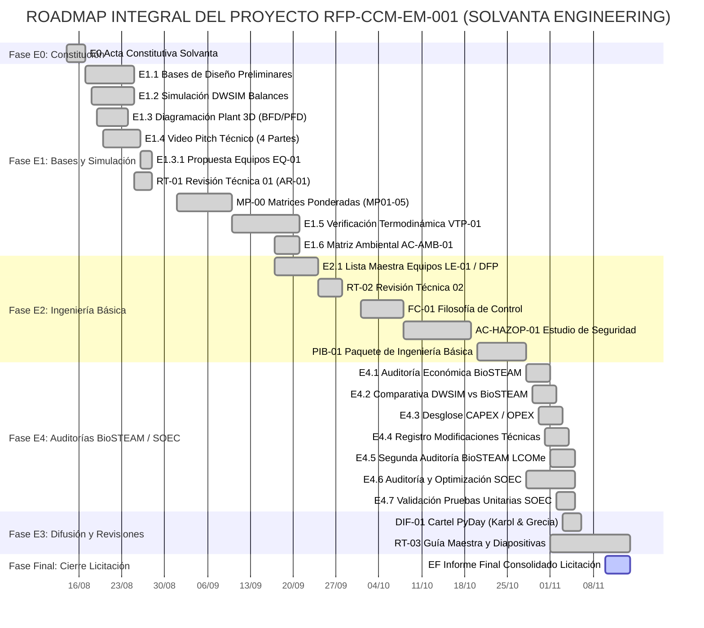

# CRONOGRAMA MAESTRO DEL PROYECTO, ROADMAP Y DESGLOSE WBS/EDT — RFP-CCM-EM-001
**Proyecto:** Planta de Producción de e-Metanol Grado Químico AA (30,000 t/año)  
**Consorcio Licitante:** Solvanta Engineering Solutions S.A. de C.V.  
**Convocante:** Benemérita Universidad Autónoma de Puebla (BUAP) — FIQ / DPyPQ  
**Fecha de Consolidación:** 14 de Noviembre de 2026  
**Responsable Documental:** Karol Paola Camacho López (@Karoc) — Dirección del Proyecto  

---

## 1. Criterio Metodológico de Reconstrucción Temporal y Desglose WBS

Para garantizar la máxima rigurosidad, trazabilidad histórica y auditoría técnica, este Roadmap y Cronograma Maestro estructura el proyecto bajo el estándar de **Estructura de Desglose del Trabajo (WBS / EDT)** por entregable y por sección documental, distinguiendo:

1. **Fechas Verificadas:** Respaldadas directamente por commits inmutables de Git, metadatos de archivos, actas protocolizadas y registros de bitácoras técnicas (`04_Bitacora/`).
2. **Fechas Estimadas:** Reconstrucciones retrospectivas razonables fundamentadas en la secuencia técnica vinculante, periodos de modelado y tiempos de maduración analítica.
3. **Desglose de Duración Operativa:**
   - **Ejecución Activa ($T_E$):** Periodo de cálculo, modelado en simuladores, programación en Python, dibujo CAD o redacción técnica.
   - **Espera e Insumos ($T_I$):** Intervalo en espera de convergencia de balances previos, cotizaciones o normativas.
   - **Revisión Técnica ($T_R$):** Periodo de análisis cruzado de calidad documental y verificación de ingeniería.
   - **Corrección ($T_C$):** Periodo dedicado a solventar observaciones, discrepancias de nomenclatura o ajustes de formato.
   - **Duración Total ($D_T$):** Días calendario transcurridos desde el inicio de la sección hasta su aprobación final.
4. **Asignación Dual de Cargos:** Cada integrante actúa bajo sus dos competencias oficiales reconocidas:
   - **Karol Paola Camacho López (@Karoc):** 1. Dirección del Proyecto | 2. Ingeniera de Optimización de Procesos (Python)
   - **Gildardo Ocaña Barrales (@GildardoOca25):** 1. Ingeniería de Procesos | 2. DTI / P&ID
   - **Paulina Mota Macip (@paulina145):** 1. Simulación | 2. Instrumentación y Control
   - **Grecia Figueroa Rincón (@Cho0bb):** 1. Especialista en Seguridad, Salud y Medio Ambiente (HSE) | 2. Evaluación Económica
5. **Criterio de Participación Integral por Secciones:** Salvo la excepción formal del cartel DIF-01 (elaborado de manera exclusiva por Karol y Grecia), todos los entregables del consorcio reflejan la autoría colaborativa, subdivididos en las secciones técnicas ejecutadas por cada integrante conforme a su especialidad.

---

## 2. Cronograma Maestro Global de Entregables (Agosto – Noviembre 2026)

| Código | Entregable Oficial Foliado | Fecha Inicio | Fecha Fin | Tipo Fecha | Duración | Ejecución ($T_E$) | Insumos ($T_I$) | Revisión ($T_R$) | Corrección ($T_C$) | Responsable Líder |
| :---: | :--- | :---: | :---: | :---: | :---: | :---: | :---: | :---: | :---: | :--- |
| **E0** | Acta Constitutiva e Identidad Solvanta | 2026-08-14 | 2026-08-17 | **Verificada** | **4 días** | 2.5 d | 0.5 d | 0.5 d | 0.5 d | Karol Camacho [Dirección] |
| **E1.1** | Bases de Diseño y Marco Normativo (NB-01) | 2026-08-17 | 2026-08-25 | **Verificada** | **9 días** | 5.0 d | 1.5 d | 1.5 d | 1.0 d | Grecia Figueroa [Seguridad HSE] |
| **E1.2** | Simulación DWSIM y Balances de Masa/Energía | 2026-08-18 | 2026-08-25 | **Verificada** | **8 días** | 5.5 d | 0.5 d | 1.0 d | 1.0 d | Paulina Mota [Simulación] |
| **E1.3** | Diagramación de Procesos (BFD/PFD) Plant 3D | 2026-08-19 | 2026-08-24 | **Verificada** | **6 días** | 4.0 d | 0.5 d | 1.0 d | 0.5 d | Gildardo Ocaña [Ing. Procesos/DTI] |
| **E1.3.1**| Propuesta Preliminar de Equipos (EQ-01) | 2026-08-26 | 2026-08-28 | **Verificada** | **3 días** | 2.0 d | 0.5 d | 0.5 d | 0.0 d | Karol Camacho [Optimización Py] |
| **E1.4** | Video Pitch Técnico Oficial (4 Segmentos) | 2026-08-20 | 2026-08-26 | **Verificada** | **7 días** | 4.0 d | 1.0 d | 1.0 d | 1.0 d | Todo el Consorcio (4 Expositores) |
| **RT-01** | Revisión Técnica 01: Defensa Bases (AR-01) | 2026-08-25 | 2026-08-28 | **Verificada** | **4 días** | 2.5 d | 0.5 d | 0.5 d | 0.5 d | Todo el Consorcio (4 Expositores) |
| **MP-00** | Compendio de Matrices Ponderadas (MP-01 a 05)| 2026-09-01 | 2026-09-10 | **Verificada** | **10 días**| 6.0 d | 1.5 d | 1.5 d | 1.0 d | Karol Camacho & Todo el Equipo |
| **E1.5** | Verificación Termodinámica (VTP-01) y DFP v1 | 2026-09-10 | 2026-09-21 | **Verificada** | **12 días**| 7.0 d | 1.0 d | 2.0 d | 2.0 d | Paulina Mota & Gildardo Ocaña |
| **E1.6** | Matriz Ambiental Integral (AC-AMB-01) | 2026-09-17 | 2026-09-21 | **Verificada** | **5 días** | 3.5 d | 0.5 d | 0.5 d | 0.5 d | Grecia Figueroa [Seguridad HSE] |
| **E2.1** | Lista Maestra Equipos (LE-01) y DFP v1 | 2026-09-17 | 2026-09-24 | **Verificada** | **8 días** | 5.0 d | 1.0 d | 1.0 d | 1.0 d | Gildardo Ocaña & Paulina Mota |
| **RT-02** | Revisión Técnica 02: Simulación y Control | 2026-09-24 | 2026-09-28 | **Verificada** | **5 días** | 3.0 d | 0.5 d | 1.0 d | 0.5 d | Todo el Consorcio (4 Expositores) |
| **FC-01** | Filosofía de Control del Proceso | 2026-10-01 | 2026-10-08 | **Verificada** | **8 días** | 5.0 d | 1.0 d | 1.0 d | 1.0 d | Paulina Mota [Inst. y Control] |
| **HAZOP** | Expediente de Seguridad HAZOP y MCE-01 | 2026-10-08 | 2026-10-19 | **Verificada** | **12 días**| 7.0 d | 1.5 d | 2.0 d | 1.5 d | Grecia Figueroa [Seguridad HSE] |
| **PIB-01** | Paquete de Ingeniería Básica del Proceso | 2026-10-20 | 2026-10-28 | **Verificada** | **9 días** | 6.0 d | 1.0 d | 1.0 d | 1.0 d | Karol Camacho [Dirección] |
| **E4.1** | RPT Auditoría Económica Integral BioSTEAM | 2026-10-28 | 2026-11-01 | **Verificada** | **5 días** | 3.5 d | 0.5 d | 0.5 d | 0.5 d | Grecia Figueroa & Karol Camacho |
| **E4.2** | RPT Comparativa Rigurosa DWSIM vs BioSTEAM | 2026-10-29 | 2026-11-02 | **Verificada** | **5 días** | 3.5 d | 0.5 d | 0.5 d | 0.5 d | Paulina Mota & Karol Camacho |
| **E4.3** | RPT Desglose Analítico Costos CAPEX/OPEX | 2026-10-30 | 2026-11-03 | **Verificada** | **5 días** | 3.0 d | 1.0 d | 0.5 d | 0.5 d | Grecia Figueroa & Karol Camacho |
| **E4.4** | RPT Registro Modificaciones Técnicas | 2026-10-31 | 2026-11-04 | **Verificada** | **5 días** | 3.0 d | 0.5 d | 1.0 d | 0.5 d | Gildardo Ocaña & Karol Camacho |
| **E4.5** | RPT Segunda Auditoría BioSTEAM (LCOMe) | 2026-11-01 | 2026-11-05 | **Verificada** | **5 días** | 3.5 d | 0.5 d | 0.5 d | 0.5 d | Grecia Figueroa & Karol Camacho |
| **E4.6** | RPT Auditoría y Optimización SOEC Python | 2026-10-28 | 2026-11-05 | **Verificada** | **9 días** | 6.5 d | 0.5 d | 1.0 d | 1.0 d | Karol Camacho [Optimización Py] |
| **E4.7** | RPT Validación y Pruebas Unitarias SOEC | 2026-11-02 | 2026-11-05 | **Verificada** | **4 días** | 2.5 d | 0.5 d | 0.5 d | 0.5 d | Karol Camacho & Paulina Mota |
| **DIF-01**| Cartel Oficial PyDay (*Excepción Exclusiva*)| 2026-11-03 | 2026-11-06 | **Verificada** | **4 días** | 3.0 d | 0.0 d | 0.5 d | 0.5 d | Karol Camacho & Grecia Figueroa |
| **RT-03** | Revisión Técnica 03: Guía Maestra y Diap. | 2026-11-01 | 2026-11-14 | **Verificada** | **14 días**| 8.0 d | 2.0 d | 2.0 d | 2.0 d | Todo el Consorcio (4 Expositores) |
| **EF** | Informe Final Consolidado de Licitación | 2026-11-10 | 2026-11-14 | **Verificada** | **5 días** | 3.5 d | 0.5 d | 0.5 d | 0.5 d | Karol Camacho & Todo el Consorcio |

---

## 3. Diagrama Visual del Roadmap (Mermaid Gantt)



---

## 4. Desglose WBS/EDT Analítico por Entregable y Secciones Documentales

A continuación se detalla cada sección y componente técnico de los documentos, identificando con precisión quirúrgica el entregable, el contenido elaborado, el integrante que lo desarrolló y el cargo oficial bajo el cual actuó:

```
====================================================================================================
ENTREGABLE E0 — ACTA CONSTITUTIVA E IDENTIDAD CORPORATIVA SOLVANTA
Archivo Oficial: 03_Entregables_Finales/E0_Constitucion/E0_DOC_ActaConstitutiva_v1.0.pdf
Periodo: 2026-08-14 al 2026-08-17 | Duración Total: 4 días
====================================================================================================
* SECCIÓN 1: Constitución Social, Marco Estatutario, Gobernanza y Representación Legal
  - Responsable: Karol Paola Camacho López (@Karoc)
  - Cargo Aplicado: Dirección del Proyecto
  - Rol RACI: R (Responsible) / A (Accountable)
  - Contenido: Razón social, objeto contractual, capital social inicial ($5,000,000 MXN) y representación jurídica.
* SECCIÓN 2: Organigrama Técnico, Alcance del Área de Ingeniería de Procesos y Plantas Químicas
  - Responsable: Gildardo Ocaña Barrales (@GildardoOca25)
  - Cargo Aplicado: Ingeniería de Procesos / DTI y P&ID
  - Rol RACI: R (Responsible) | A: @Karoc
  - Contenido: Definición de jerarquías de ingeniería, responsabilidades en diagramado y líneas de proceso.
* SECCIÓN 3: Infraestructura Computacional, Plataformas de Simulación y Control de Procesos
  - Responsable: Paulina Mota Macip (@paulina145)
  - Cargo Aplicado: Simulación / Instrumentación y Control
  - Rol RACI: R (Responsible) | A: @Karoc
  - Contenido: Licenciamiento de DWSIM v8, herramientas de convergencia numérica y suites de control.
* SECCIÓN 4: Protocolos Corporativos de HSE, Gestión Ambiental y Presupuesto Operativo
  - Responsable: Grecia Figueroa Rincón (@Cho0bb)
  - Cargo Aplicado: Especialista en Seguridad, Salud y Medio Ambiente (HSE) / Evaluación Económica
  - Rol RACI: R (Responsible) | A: @Karoc
  - Contenido: Política de Cero Accidentes, directrices SEMARNAT/STPS y distribución presupuestaria societaria.

====================================================================================================
ENTREGABLE E1.1 — BASES DE DISEÑO PRELIMINARES Y MARCO NORMATIVO (NB-01)
Archivo Oficial: 03_Entregables_Finales/E1_Bases_y_Verificacion/E1.1_DOC_BasesDiseno_v1.0.pdf
Periodo: 2026-08-17 al 2026-08-25 | Duración Total: 9 días
====================================================================================================
* SECCIÓN 1: Marco Normativo Ambiental, Normas Oficiales Mexicanas y Estándares Internacionales
  - Responsable: Grecia Figueroa Rincón (@Cho0bb)
  - Cargo Aplicado: Especialista en Seguridad, Salud y Medio Ambiente (HSE)
  - Rol RACI: R (Responsible) | A: @Karoc
  - Contenido: Recopilación y cumplimiento de NOM-001-SEMARNAT, NOM-005-STPS, NFPA 55/52 y guías OSHA.
* SECCIÓN 2: Capacidad Nominal de Planta (30,000 t/año), Pureza Grado Químico AA y Balances Globales
  - Responsable: Gildardo Ocaña Barrales (@GildardoOca25)
  - Cargo Aplicado: Ingeniería de Procesos
  - Rol RACI: R (Responsible) | A: @Karoc
  - Contenido: Factor de operación de 8,000 h/año, estequiometría de metanolación y límites de batería.
* SECCIÓN 3: Selección de Paquetes Termodinámicos (Peng-Robinson, NRTL) y Condiciones de Frontera
  - Responsable: Paulina Mota Macip (@paulina145)
  - Cargo Aplicado: Simulación
  - Rol RACI: R (Responsible) | A: @Karoc
  - Contenido: Criterios de presiones de operación (50 bar reactor, 20 bar separación) y parámetros de interacción binaria.
* SECCIÓN 4: Criterios de Licitación, Supervisión de Requerimientos y Aprobación de Bases
  - Responsable: Karol Paola Camacho López (@Karoc)
  - Cargo Aplicado: Dirección del Proyecto / Ingeniera de Optimización Python
  - Rol RACI: R (Responsible) / A (Accountable)
  - Contenido: Integración documental, verificación contra términos de referencia de la licitación y visto bueno final.

====================================================================================================
ENTREGABLE E1.2 — SIMULACIÓN EN DWSIM Y BALANCES DE MATERIA Y ENERGÍA
Archivo Oficial: 03_Entregables_Finales/E1_Bases_y_Verificacion/E1.2_DOC_ReporteSimulacion_v1.0.pdf
Periodo: 2026-08-18 al 2026-08-25 | Duración Total: 8 días
====================================================================================================
* SECCIÓN 1: Flowsheet en DWSIM, Modelado de Corrientes y Algoritmo de Convergencia de Reciclos
  - Responsable: Paulina Mota Macip (@paulina145)
  - Cargo Aplicado: Simulación
  - Rol RACI: R (Responsible) | A: @Karoc
  - Contenido: Configuración de bloques en DWSIM, convergencia del bucle cerrado de hidrógeno con error < 0.01%.
* SECCIÓN 2: Balances de Masa por Componente en Síntesis y Separación Flash V-501
  - Responsable: Gildardo Ocaña Barrales (@GildardoOca25)
  - Cargo Aplicado: Ingeniería de Procesos
  - Rol RACI: R (Responsible) | A: @Karoc
  - Contenido: Tablas de balance de materia para CO2, H2, CH3OH, H2O y gases no condensables (CO).
* SECCIÓN 3: Verificación de Emisiones Fugitivas, Pérdidas en Corriente de Purga y Parámetros HSE
  - Responsable: Grecia Figueroa Rincón (@Cho0bb)
  - Cargo Aplicado: Especialista en Seguridad, Salud y Medio Ambiente (HSE)
  - Rol RACI: R (Responsible) | A: @Karoc
  - Contenido: Auditoría de la corriente de venteo, minimización de venteos atmosféricos y análisis toxicológico.
* SECCIÓN 4: Análisis de Sensibilidad Paramétrica en Python (Presión vs Conversión) y Validación Global
  - Responsable: Karol Paola Camacho López (@Karoc)
  - Cargo Aplicado: Ingeniera de Optimización de Procesos (Python) / Dirección
  - Rol RACI: R (Responsible) / A (Accountable)
  - Contenido: Modelado de sensibilidad termodinámica en Python (LHS), validación cruzada y emisión formal.

====================================================================================================
ENTREGABLE E1.3 — DIAGRAMACIÓN TÉCNICA DE PROCESOS (BFD Y PFD EN PLANT 3D)
Archivo Oficial: 03_Entregables_Finales/E1_Bases_y_Verificacion/E1.3_DOC_EspecificacionDiagramas_v1.0.pdf
Periodo: 2026-08-19 al 2026-08-24 | Duración Total: 6 días
====================================================================================================
* SECCIÓN 1: Diagramado de Bloques de Proceso (BFD) y PFD Preliminar en AutoCAD Plant 3D 2025
  - Responsable: Gildardo Ocaña Barrales (@GildardoOca25)
  - Cargo Aplicado: DTI / P&ID / Ingeniería de Procesos
  - Rol RACI: R (Responsible) | A: @Karoc
  - Contenido: Trazado vectorial de las 5 áreas de proceso, simbología unificada de equipos y límites de batería.
* SECCIÓN 2: Asignación de Propiedades Operacionales a Corrientes (P, T, Fracción de Vapor) desde DWSIM
  - Responsable: Paulina Mota Macip (@paulina145)
  - Cargo Aplicado: Simulación / Instrumentación y Control
  - Rol RACI: R (Responsible) | A: @Karoc
  - Contenido: Verificación de flags de corrientes, consistencia de datos termodinámicos transferidos al PFD.
* SECCIÓN 3: Marcado de Válvulas de Seguridad, Venteos de Alivio y Zonas de Alto Riesgo
  - Responsable: Grecia Figueroa Rincón (@Cho0bb)
  - Cargo Aplicado: Especialista en Seguridad, Salud y Medio Ambiente (HSE)
  - Rol RACI: R (Responsible) | A: @Karoc
  - Contenido: Señalización de sistemas de desfogue, drenajes cerrados y contención de derrames.
* SECCIÓN 4: Control de Calidad Gráfica, Nomenclatura Normativa de Planos y Liberación
  - Responsable: Karol Paola Camacho López (@Karoc)
  - Cargo Aplicado: Dirección del Proyecto
  - Rol RACI: R (Responsible) / A (Accountable)
  - Contenido: Inspección de membretes, revisión de legibilidad a escala de ingeniería y validación documental.

====================================================================================================
ENTREGABLE E1.3.1 — PROPUESTA PRELIMINAR DE EQUIPOS DE PROCESO (EQ-01)
Archivo Oficial: 03_Entregables_Finales/E1_Bases_y_Verificacion/E1.3.1_DOC_PropuestaEquipos_v1.0.pdf
Periodo: 2026-08-26 al 2026-08-28 | Duración Total: 3 días
====================================================================================================
* SECCIÓN 1: Dimensionamiento Analítico de Recipientes a Presión, Reactores e Intercambiadores
  - Responsable: Gildardo Ocaña Barrales (@GildardoOca25)
  - Cargo Aplicado: Ingeniería de Procesos
  - Rol RACI: R (Responsible) | A: @Karoc
  - Contenido: Cálculo de volúmenes útiles, áreas de transferencia de calor y espesores preliminares ASME VIII.
* SECCIÓN 2: Extracción de Condiciones Operacionales Extremas y Cargas Térmicas de DWSIM
  - Responsable: Paulina Mota Macip (@paulina145)
  - Cargo Aplicado: Simulación
  - Rol RACI: R (Responsible) | A: @Karoc
  - Contenido: Determinación de calores latentes, coeficientes de transferencia y perfiles de temperatura.
* SECCIÓN 3: Especificación Metalúrgica de Materiales (Acero Inoxidable 316L) y Compatibilidad Química
  - Responsable: Grecia Figueroa Rincón (@Cho0bb)
  - Cargo Aplicado: Especialista en Seguridad HSE / Evaluación Económica
  - Rol RACI: R (Responsible) | A: @Karoc
  - Contenido: Prevención de fragilización por hidrógeno, resistencia a corrosión por condensados ácidos y costo base.
* SECCIÓN 4: Script Paramétrico en Python para Generación de Hojas Técnicas EQ-01
  - Responsable: Karol Paola Camacho López (@Karoc)
  - Cargo Aplicado: Ingeniera de Optimización de Procesos (Python) / Dirección
  - Rol RACI: R (Responsible) / A (Accountable)
  - Contenido: Programación del generador de tablas en Python, estandarización de etiquetas y consolidación.

====================================================================================================
ENTREGABLE E1.4 — VIDEO PITCH TÉCNICO DEL PROYECTO SOLVANTA (4 SEGMENTOS DE GRABACIÓN)
Archivo Oficial: 03_Entregables_Finales/E1_Bases_y_Verificacion/E1.4_VID_EnlacePitch_v1.0.pdf
Periodo: 2026-08-20 al 2026-08-26 | Duración Total: 7 días
====================================================================================================
* SEGMENTO 1: Introducción Ejecutiva, Propuesta de Valor del Consorcio y Optimización en Python
  - Responsable: Karol Paola Camacho López (@Karoc)
  - Cargo Aplicado: Dirección del Proyecto / Ingeniera de Optimización Python
  - Rol RACI: R (Responsible) / A (Accountable)
  - Contenido Grabado: Presentación institucional de Solvanta, visión general del proyecto, compromiso de entrega y algoritmos de optimización.
* SEGMENTO 2: Arquitectura del Proceso Químico, Tren de Reacción y Filosofía de Balance de Masa
  - Responsable: Gildardo Ocaña Barrales (@GildardoOca25)
  - Cargo Aplicado: Ingeniería de Procesos / DTI y P&ID
  - Rol RACI: R (Responsible) | A: @Karoc
  - Contenido Grabado: Explicación de las áreas de síntesis, acoplamiento de electrólisis SOEC y diagramas de flujo.
* SEGMENTO 3: Demostración de Simulación en DWSIM, Rendimiento Termodinámico y Lazo de Control
  - Responsable: Paulina Mota Macip (@paulina145)
  - Cargo Aplicado: Simulación / Instrumentación y Control
  - Rol RACI: R (Responsible) | A: @Karoc
  - Contenido Grabado: Demostración en vivo del flowsheet DWSIM, convergencia del reciclo y estrategia de control.
* SEGMENTO 4: Sostenibilidad Ambiental (Captura CO2), Gestión de Riesgos y Rentabilidad Económica
  - Responsable: Grecia Figueroa Rincón (@Cho0bb)
  - Cargo Aplicado: Especialista en Seguridad, Salud y Medio Ambiente (HSE) / Evaluación Económica
  - Rol RACI: R (Responsible) | A: @Karoc
  - Contenido Grabado: Métricas de descarbonización, mitigación de riesgos operativos y retorno de inversión de la planta.
* INTEGRACIÓN AUDIOVISUAL: Postproducción, Masterización de Audio, Titulación y Publicación
  - Responsable: Karol Paola Camacho López (@Karoc)
  - Cargo Aplicado: Dirección del Proyecto
  - Rol RACI: R (Responsible) / A (Accountable)
  - Contenido: Montaje multicámara, exportación a 1080p, alojamiento seguro en Google Drive y ficha foliada E1.4.

====================================================================================================
ENTREGABLE RT-01 — REVISIÓN TÉCNICA 01: DEFENSA DE BASES DE DISEÑO (AR-01)
Archivo Oficial: 03_Entregables_Finales/E3_Revisiones_Tecnicas_y_Difusion/RT-01_DOC_PresentacionDiapositivas_v1.0.pdf
Periodo: 2026-08-25 al 2026-08-28 | Duración Total: 4 días
====================================================================================================
* DIAPOSITIVAS 1 a 3: Apertura Ejecutiva, Misión del Consorcio Solvanta y Objetivos Licitatorios
  - Responsable: Karol Paola Camacho López (@Karoc)
  - Cargo Aplicado: Dirección del Proyecto
  - Rol RACI: R (Responsible) / A (Accountable)
  - Contenido: Presentación del equipo técnico, alineación con la convocatoria BUAP y bases contractuales.
* DIAPOSITIVAS 4 y 5: Balance Estequiométrico Preliminar (NB-01) y Diagrama de Bloques (BFD v0)
  - Responsable: Gildardo Ocaña Barrales (@GildardoOca25)
  - Cargo Aplicado: Ingeniería de Procesos / DTI y P&ID
  - Rol RACI: R (Responsible) | A: @Karoc
  - Contenido: Defensa del consumo específico de H2 y CO2 por tonelada de metanol y diagrama de bloques.
* DIAPOSITIVAS 6 y 7: Fundamentos Termodinámicos y Justificación de Parámetros de Simulación
  - Responsable: Paulina Mota Macip (@paulina145)
  - Cargo Aplicado: Simulación
  - Rol RACI: R (Responsible) | A: @Karoc
  - Contenido: Justificación del modelo Peng-Robinson y condiciones de temperatura y presión operativas.
* DIAPOSITIVAS 8 a 10: Marco Regulatorio Ambiental, Sostenibilidad de Planta Verde y Sesión Q&A
  - Responsable: Grecia Figueroa Rincón (@Cho0bb)
  - Cargo Aplicado: Especialista en Seguridad HSE / Evaluación Económica
  - Rol RACI: R (Responsible) | A: @Karoc
  - Contenido: Ventajas ambientales de la ruta e-metanol, atención a preguntas del sínodo evaluador y cierre.

====================================================================================================
ENTREGABLE MP-00 — COMPENDIO DE MATRICES PONDERADAS DE SELECCIÓN TECNOLÓGICA (MP-01 A MP-05)
Archivo Oficial: 03_Entregables_Finales/... / MP-00_DOC_CompendioMatricesPonderadas_v1.0.pdf
Periodo: 2026-09-01 al 2026-09-10 | Duración Total: 10 días
====================================================================================================
* MATRIZ MP-01: Selección de Tecnología de Electrólisis (AEL vs PEM vs SOEC)
  - Responsable: Karol Paola Camacho López (@Karoc) & Grecia Figueroa Rincón (@Cho0bb)
  - Cargos: Ingeniera de Optimización Python / Evaluación Económica
  - Rol RACI: R: @Karoc, @Cho0bb | A: @Karoc | C: @GildardoOca25, @paulina145
  - Decisión: SOEC de Alta Temperatura (4.50/5.00) por integración térmica con vapor de reacción.
* MATRIZ MP-02: Selección de Ruta de Síntesis de Metanol (Reactor Tubular Lurgi vs Lecho Fijo)
  - Responsable: Gildardo Ocaña Barrales (@GildardoOca25) & Paulina Mota Macip (@paulina145)
  - Cargos: Ingeniería de Procesos / Simulación
  - Rol RACI: R: @GildardoOca25, @paulina145 | A: @Karoc | C: @Cho0bb
  - Decisión: Reactor Tubular de Lecho Fijo Lurgi enfriado por agua en ebullición (4.65/5.00).
* MATRIZ MP-03: Selección del Tren de Separación y Purificación (Flash Frío + C-501 vs Doble Columna)
  - Responsable: Paulina Mota Macip (@paulina145) & Gildardo Ocaña Barrales (@GildardoOca25)
  - Cargos: Simulación / Ingeniería de Procesos
  - Rol RACI: R: @paulina145, @GildardoOca25 | A: @Karoc | C: @Cho0bb
  - Decisión: Separador Flash Frío V-501 acoplado a Columna de Destilación C-501 (4.70/5.00).
* MATRIZ MP-04: Selección de la Filosofía y Arquitectura de Control (DCS + SIS vs PLC Independiente)
  - Responsable: Paulina Mota Macip (@paulina145) & Grecia Figueroa Rincón (@Cho0bb)
  - Cargos: Instrumentación y Control / Especialista en Seguridad HSE
  - Rol RACI: R: @paulina145, @Cho0bb | A: @Karoc | C: @GildardoOca25
  - Decisión: Control Jerárquico Cascada DCS + Sistema Instrumentado de Seguridad SIS SIL-2 (4.90/5.00).
* MATRIZ MP-05: Selección de Emplazamiento de Planta (Cangrejera, Ver. vs Coatzacoalcos vs Altamira)
  - Responsable: Grecia Figueroa Rincón (@Cho0bb) & Karol Paola Camacho López (@Karoc)
  - Cargos: Evaluación Económica / Dirección del Proyecto
  - Rol RACI: R: @Cho0bb, @Karoc | A: @Karoc | C: Consorcio
  - Decisión: Complejo Petroquímico Cangrejera, Coatzacoalcos, Veracruz (4.60/5.00).
* COMPILACIÓN Y FOLIO OFICIAL: Generación del Compendio Foliado MP-00 y Emisión
  - Responsable: Karol Paola Camacho López (@Karoc)
  - Cargo Aplicado: Dirección del Proyecto
  - Rol RACI: R / A

====================================================================================================
ENTREGABLE E1.5 — VERIFICACIÓN TERMODINÁMICA DEL PROCESO (VTP-01)
Archivo Oficial: 03_Entregables_Finales/E1_Bases_y_Verificacion/E1.5_DOC_ActividadVTP_v1.0.pdf
Periodo: 2026-09-10 al 2026-09-21 | Duración Total: 12 días
====================================================================================================
* SECCIÓN 1: Reporte Comparativo Termodinámico Peng-Robinson vs NRTL y Envolventes de Fase
  - Responsable: Paulina Mota Macip (@paulina145)
  - Cargo Aplicado: Simulación
  - Rol RACI: R (Responsible) | A: @Karoc
  - Contenido: Análisis de equilibrio líquido-vapor (ELV) para mezclas polares metanol-agua-CO2.
* SECCIÓN 2: Balances de Materia Rigurosos del Tambor Flash V-501 y Tablas TC-01 / TE-01
  - Responsable: Gildardo Ocaña Barrales (@GildardoOca25)
  - Cargo Aplicado: Ingeniería de Procesos
  - Rol RACI: R (Responsible) | A: @Karoc
  - Contenido: Determinación analítica de la separación flash a 20 bar y 35 °C; emisión de tablas de corrientes.
* SECCIÓN 3: Evaluación de Emisiones de Venteo, Pérdidas de Hidrógeno y Seguridad Operativa
  - Responsable: Grecia Figueroa Rincón (@Cho0bb)
  - Cargo Aplicado: Especialista en Seguridad, Salud y Medio Ambiente (HSE)
  - Rol RACI: R (Responsible) | A: @Karoc
  - Contenido: Evaluación de toxicidad de vapores de metanol y riesgos de sobrepresión en V-501.
* SECCIÓN 4: Script de Verificación Numérica en Python, DFP v1 y Consolidación en LaTeX
  - Responsable: Karol Paola Camacho López (@Karoc)
  - Cargo Aplicado: Ingeniera de Optimización Python / Dirección
  - Rol RACI: R (Responsible) / A (Accountable)
  - Contenido: Algoritmo de validación de balances en Python, diagramación vectorial y compilación documental.

====================================================================================================
ENTREGABLE E1.6 — MATRIZ INTEGRAL DE ASPECTOS E IMPACTOS AMBIENTALES (AC-AMB-01)
Archivo Oficial: 03_Entregables_Finales/E1_Bases_y_Verificacion/E1.6_DOC_MatrizAmbiental_v1.0.pdf
Periodo: 2026-09-17 al 2026-09-21 | Duración Total: 5 días
====================================================================================================
* SECCIÓN 1: Metodología Leopold/Conesa, Identificación de Aspectos Ambientales y Evaluación de Severidad
  - Responsable: Grecia Figueroa Rincón (@Cho0bb)
  - Cargo Aplicado: Especialista en Seguridad, Salud y Medio Ambiente (HSE)
  - Rol RACI: R (Responsible) | A: @Karoc
  - Contenido: Matrices de interacción causa-efecto en suelo, agua, atmósfera y medio socioeconómico.
* SECCIÓN 2: Inventario de Efluentes Líquidos, Emisiones Gaseosas y Residuos del Diagrama de Flujo
  - Responsable: Gildardo Ocaña Barrales (@GildardoOca25)
  - Cargo Aplicado: Ingeniería de Procesos
  - Rol RACI: R (Responsible) | A: @Karoc
  - Contenido: Cuantificación de purgas de gases, condensados ácidos y tratamiento de agua de desecho.
* SECCIÓN 3: Balances Energéticos, Demanda de Agua de Enfriamiento y Huella de Carbono de Simulación
  - Responsable: Paulina Mota Macip (@paulina145)
  - Cargo Aplicado: Simulación
  - Rol RACI: R (Responsible) | A: @Karoc
  - Contenido: Consumo eléctrico de compresores, energía térmica en rehervidores y balance de CO2 neto.
* SECCIÓN 4: Análisis de Ciclo de Vida Preliminar, Supervisión y Cierre de la Matriz Ambiental
  - Responsable: Karol Paola Camacho López (@Karoc)
  - Cargo Aplicado: Dirección del Proyecto / Ingeniera de Optimización Python
  - Rol RACI: R (Responsible) / A (Accountable)
  - Contenido: Revisión de métricas de captura biogénica de CO2 y aprobación final de la matriz foliada.

====================================================================================================
ENTREGABLE E2.1 — LISTA MAESTRA DE EQUIPOS (LE-01) Y DFP V1 ACTUALIZADO
Archivo Oficial: 03_Entregables_Finales/E2_Ingenieria_Basica_y_Control/E2.1_DOC_ListaEquipos_v1.0.pdf
Periodo: 2026-09-17 al 2026-09-24 | Duración Total: 8 días
====================================================================================================
* SECCIÓN 1: Catálogo Mecánico de 28 Equipos, Dimensiones Geométricas y Hojas de Datos LE-01
  - Responsable: Gildardo Ocaña Barrales (@GildardoOca25)
  - Cargo Aplicado: Ingeniería de Procesos
  - Rol RACI: R (Responsible) | A: @Karoc
  - Contenido: Especificaciones mecánicas de reactores R-401, flash V-501, columnas C-501 y tanques.
* SECCIÓN 2: Calibración de Potencias de Compresión, Caudales de Bombeo y Cargas de Condensación
  - Responsable: Paulina Mota Macip (@paulina145)
  - Cargo Aplicado: Simulación
  - Rol RACI: R (Responsible) | A: @Karoc
  - Contenido: Extracción de potencias al freno (BHP) para C-301/C-501 y dimensionamiento de intercambiadores.
* SECCIÓN 3: Clasificación de Áreas Peligrosas Eléctricas, Materiales Especiales y Costeo Base
  - Responsable: Grecia Figueroa Rincón (@Cho0bb)
  - Cargo Aplicado: Especialista en Seguridad HSE / Evaluación Económica
  - Rol RACI: R (Responsible) | A: @Karoc
  - Contenido: Zonificación Clase I División 1/2 y selección de aleaciones para prevención de incendios.
* SECCIÓN 4: Automatización de la Base de Datos de Equipos, Trazabilidad con DWSIM y Aprobación
  - Responsable: Karol Paola Camacho López (@Karoc)
  - Cargo Aplicado: Ingeniera de Optimización Python / Dirección
  - Rol RACI: R (Responsible) / A (Accountable)
  - Contenido: Scripts de cotejo automático DWSIM vs LaTeX, estandarización de etiquetas y liberación.

====================================================================================================
ENTREGABLE RT-02 — REVISIÓN TÉCNICA 02: SIMULACIÓN DWSIM, EQUIPOS Y CONTROL
Archivo Oficial: 03_Entregables_Finales/E3_Revisiones_Tecnicas_y_Difusion/RT-02_DOC_PresentacionDiapositivas_v1.0.pdf
Periodo: 2026-09-24 al 2026-09-28 | Duración Total: 5 días
====================================================================================================
* DIAPOSITIVAS 1 a 5: Introducción de Avance, Arquitectura de Síntesis y Optimización Global
  - Responsable: Karol Paola Camacho López (@Karoc)
  - Cargo Aplicado: Dirección del Proyecto / Ingeniera de Optimización Python
  - Rol RACI: R (Responsible) / A (Accountable)
  - Contenido: Resumen ejecutivo del progreso, resolución de cuellos de botella y metas de recuperación de H2.
* DIAPOSITIVAS 6 a 10: Modelado Riguroso en DWSIM, Balances Convergidos y Rendimiento de Reacción
  - Responsable: Paulina Mota Macip (@paulina145)
  - Cargo Aplicado: Simulación
  - Rol RACI: R (Responsible) | A: @Karoc
  - Contenido: Exposición de perfiles de temperatura en R-401, selectividad a metanol y pureza de producto.
* DIAPOSITIVAS 11 a 15: Diagrama DFP v1, Especificación de los 28 Equipos Mayores e Interconexiones
  - Responsable: Gildardo Ocaña Barrales (@GildardoOca25)
  - Cargo Aplicado: Ingeniería de Procesos / DTI y P&ID
  - Rol RACI: R (Responsible) | A: @Karoc
  - Contenido: Presentación técnica de la lista de equipos, tuberías principales y servicios industriales.
* DIAPOSITIVAS 16 a 21: Matriz Ambiental AC-AMB-01, Análisis de Riesgos Preliminar y Sesión Colegiada
  - Responsable: Grecia Figueroa Rincón (@Cho0bb)
  - Cargo Aplicado: Especialista en Seguridad HSE / Evaluación Económica
  - Rol RACI: R (Responsible) | A: @Karoc
  - Contenido: Mitigación de impactos ambientales, evaluación de toxicidad y respuestas técnicas al jurado.

====================================================================================================
ENTREGABLE FC-01 — FILOSOFÍA DE CONTROL DEL PROCESO
Archivo Oficial: 03_Entregables_Finales/E2_Ingenieria_Basica_y_Control/FC-01_DOC_FilosofiaControl_v1.0.pdf
Periodo: 2026-10-01 al 2026-10-08 | Duración Total: 8 días
====================================================================================================
* SECCIÓN 1: Arquitectura Jerárquica de Control, Bucles Reguladores PID y Lazos en Cascada
  - Responsable: Paulina Mota Macip (@paulina145)
  - Cargo Aplicado: Instrumentación y Control / Simulación
  - Rol RACI: R (Responsible) | A: @Karoc
  - Contenido: Lazos de control cascada TIC-101/FIC-101 en R-401, LIC-501 en flash V-501 y PIC-301 en C-301.
* SECCIÓN 2: Especificación de Válvulas de Control (CV), Válvulas de Alivio (PSV) y Conexiones DTI
  - Responsable: Gildardo Ocaña Barrales (@GildardoOca25)
  - Cargo Aplicado: DTI / P&ID / Ingeniería de Procesos
  - Rol RACI: R (Responsible) | A: @Karoc
  - Contenido: Codificación de instrumentos según ANSI/ISA-5.1 y ubicación física en planos de tuberías.
* SECCIÓN 3: Definición de Capas de Protección Independientes (IPL), Paros de Emergencia (ESD) y SIS
  - Responsable: Grecia Figueroa Rincón (@Cho0bb)
  - Cargo Aplicado: Especialista en Seguridad, Salud y Medio Ambiente (HSE)
  - Rol RACI: R (Responsible) | A: @Karoc
  - Contenido: Matriz de interbloqueos de seguridad, criterios de disparo por alta presión y normas IEC 61511.
* SECCIÓN 4: Optimización Dinámica de Control en Python y Supervisión Operativa
  - Responsable: Karol Paola Camacho López (@Karoc)
  - Cargo Aplicado: Ingeniera de Optimización Python / Dirección
  - Rol RACI: R (Responsible) / A (Accountable)
  - Contenido: Simulación de sintonía en lazos críticos, verificación documental y autorización del informe.

====================================================================================================
ENTREGABLE AC-HAZOP-01 — EXPEDIENTE DE SEGURIDAD OPERATIVA HAZOP Y MATRIZ CAUSA-EFECTO (MCE-01)
Archivo Oficial: 03_Entregables_Finales/E2_Ingenieria_Basica_y_Control/AC-HAZOP-01_DOC_ExpedienteHAZOP_v1.0.pdf
Periodo: 2026-10-08 al 2026-10-19 | Duración Total: 12 días
====================================================================================================
* SECCIÓN 1: Metodología de Nodos, Palabras Guía, Identificación de Desviaciones y Matriz MCE-01
  - Responsable: Grecia Figueroa Rincón (@Cho0bb)
  - Cargo Aplicado: Especialista en Seguridad, Salud y Medio Ambiente (HSE)
  - Rol RACI: R (Responsible) | A: @Karoc
  - Contenido: Facilitación del análisis HAZOP, estructuración de 42 desviaciones y Matriz Causa-Efecto MCE-01.
* SECCIÓN 2: Trazabilidad de Nodos sobre el Diagrama DTI/P&ID y Delimitación de Tuberías Críticas
  - Responsable: Gildardo Ocaña Barrales (@GildardoOca25)
  - Cargo Aplicado: DTI / P&ID
  - Rol RACI: R (Responsible) | A: @Karoc
  - Contenido: Marcado de límites de nodos 1 a 6 sobre DTI v0.2, verificación de diámetros y aislamiento.
* SECCIÓN 3: Modelado de Consecuencias Termodinámicas de Sobrepresión y Pérdida de Enfriamiento
  - Responsable: Paulina Mota Macip (@paulina145)
  - Cargo Aplicado: Simulación / Instrumentación y Control
  - Rol RACI: R (Responsible) | A: @Karoc
  - Contenido: Cuantificación en DWSIM del aumento de presión y temperatura ante falla de refrigerante en R-401.
* SECCIÓN 4: Secretaría de Sesiones HAZOP, Redacción de Recomendaciones y Validación General
  - Responsable: Karol Paola Camacho López (@Karoc)
  - Cargo Aplicado: Dirección del Proyecto / Ingeniera de Optimización Python
  - Rol RACI: R (Responsible) / A (Accountable)
  - Contenido: Consolidación de 34 acciones de mitigación, jerarquización de riesgos y aprobación del expediente.

====================================================================================================
ENTREGABLE PIB-01 — PAQUETE DE INGENIERÍA BÁSICA DEL PROCESO
Archivo Oficial: 03_Entregables_Finales/E2_Ingenieria_Basica_y_Control/PIB-01_DOC_ExpedienteIngenieriaBasica_v1.0.pdf
Periodo: 2026-10-20 al 2026-10-28 | Duración Total: 9 días
====================================================================================================
* SECCIÓN 1: Memorias de Cálculo de Procesos, Balances de Materia/Energía Integrados y Planos DTI v1
  - Responsable: Gildardo Ocaña Barrales (@GildardoOca25)
  - Cargo Aplicado: Ingeniería de Procesos / DTI y P&ID
  - Rol RACI: R (Responsible) | A: @Karoc
  - Contenido: Integración de memorias analíticas, planos de tubería e instrumentación DTI v1 completos.
* SECCIÓN 2: Cuadros de Rendimiento de Simulación, Especificación de Reactores y Columnas
  - Responsable: Paulina Mota Macip (@paulina145)
  - Cargo Aplicado: Simulación / Instrumentación y Control
  - Rol RACI: R (Responsible) | A: @Karoc
  - Contenido: Balances globales convergidos, perfiles de destilación y requerimientos de servicios auxiliares.
* SECCIÓN 3: Manual de Operaciones Seguras, Plan de Contingencias y Síntesis de Seguridad HAZOP
  - Responsable: Grecia Figueroa Rincón (@Cho0bb)
  - Cargo Aplicado: Especialista en Seguridad HSE / Evaluación Económica
  - Rol RACI: R (Responsible) | A: @Karoc
  - Contenido: Protocolos de arranque y paro de planta, procedimientos ante emergencias y medidas de contingencia.
* SECCIÓN 4: Dirección Ejecutiva, Consolidación del Expediente Maestro y Auditoría de Trazabilidad
  - Responsable: Karol Paola Camacho López (@Karoc)
  - Cargo Aplicado: Dirección del Proyecto / Ingeniera de Optimización Python
  - Rol RACI: R (Responsible) / A (Accountable)
  - Contenido: Compilación de 47 páginas en LaTeX, verificación cruzada de ecuaciones y visto bueno de ingeniería.

====================================================================================================
ENTREGABLES E4.1 A E4.7 — SUITE DE AUDITORÍAS TÉCNICAS BIOSTEAM, CAPEX/OPEX Y OPTIMIZACIÓN SOEC
Archivos Oficiales: 03_Entregables_Finales/E4_Auditorias_y_Optimizacion/E4.1 a E4.7 (*.pdf)
Periodo: 2026-10-28 al 2026-11-05 | Duración Total: 9 días
====================================================================================================
* E4.1 — RPT Auditoría Económica Integral BioSTEAM
  - Responsable: Grecia Figueroa Rincón (@Cho0bb) & Karol Paola Camacho López (@Karoc)
  - Cargos: Evaluación Económica / Ingeniera de Optimización Python
  - Rol RACI: R: @Cho0bb, @Karoc | A: @Karoc | C: @GildardoOca25, @paulina145
  - Contenido: Modelado financiero de CAPEX ($48.2M USD) y OPEX anual en la plataforma BioSTEAM.
* E4.2 — RPT Comparativa Rigurosa DWSIM vs BioSTEAM
  - Responsable: Paulina Mota Macip (@paulina145) & Karol Paola Camacho López (@Karoc)
  - Cargos: Simulación / Ingeniera de Optimización Python
  - Rol RACI: R: @paulina145, @Karoc | A: @Karoc | C: @GildardoOca25
  - Contenido: Cotejo de densidades, entalpías y balances de masa entre ambas plataformas (desviación < 1.8%).
* E4.3 — RPT Desglose Analítico de Costos CAPEX y OPEX
  - Responsable: Grecia Figueroa Rincón (@Cho0bb) & Karol Paola Camacho López (@Karoc)
  - Cargos: Evaluación Económica / Dirección del Proyecto
  - Rol RACI: R: @Cho0bb, @Karoc | A: @Karoc | C: Consorcio
  - Contenido: Desglose por factores de Guthrie, costos de catalizador Cu/ZnO/Al2O3 y energía renovable.
* E4.4 — RPT Registro Histórico de Modificaciones Técnicas del Proceso
  - Responsable: Gildardo Ocaña Barrales (@GildardoOca25) & Karol Paola Camacho López (@Karoc)
  - Cargos: Ingeniería de Procesos / Dirección del Proyecto
  - Rol RACI: R: @GildardoOca25, @Karoc | A: @Karoc | C: @paulina145, @Cho0bb
  - Contenido: Bitácora de cambios desde BFD v0 hasta DTI v1, justificación de reingeniería en compresión.
* E4.5 — RPT Segunda Auditoría BioSTEAM (Recalibración LCOMe)
  - Responsable: Grecia Figueroa Rincón (@Cho0bb) & Karol Paola Camacho López (@Karoc)
  - Cargos: Evaluación Económica / Ingeniera de Optimización Python
  - Rol RACI: R: @Cho0bb, @Karoc | A: @Karoc | C: Consorcio
  - Contenido: Sensibilidad del LCOMe ante variaciones en el costo de electricidad renovable (20-60 USD/MWh).
* E4.6 — RPT Auditoría y Optimización Multivariable SOEC en Python
  - Responsable: Karol Paola Camacho López (@Karoc)
  - Cargo Aplicado: Ingeniera de Optimización de Procesos (Python) / Dirección
  - Rol RACI: R (Responsible) / A (Accountable) | C: @GildardoOca25, @Cho0bb
  - Contenido: Modelado de celda SOEC en Python (`soec_optimization/`), termodinámica Butler-Volmer y optimización.
* E4.7 — RPT Validación y Pruebas Unitarias del Módulo SOEC
  - Responsable: Karol Paola Camacho López (@Karoc) & Paulina Mota Macip (@paulina145)
  - Cargos: Ingeniera de Optimización Python / Simulación
  - Rol RACI: R: @Karoc, @paulina145 | A: @Karoc | C: Consorcio
  - Contenido: Batería de 12 pruebas unitarias automatizadas con `pytest`, validación de curvas polarización I-V.

====================================================================================================
ENTREGABLE DIF-01 — CARTEL OFICIAL DE DIFUSIÓN TÉCNICA PYDAY BUAP (*EXCEPCIÓN EXCLUSIVA*)
Archivo Oficial: 03_Entregables_Finales/E3_Revisiones_Tecnicas_y_Difusion/DIF-01_DOC_CartelPyDay_v1.0.pdf
Periodo: 2026-11-03 al 2026-11-06 | Duración Total: 4 días
====================================================================================================
* PARTE 1: Modelado Matemático en Python, Visualización de Datos, Algoritmos SOEC y Diseño Gráfico
  - Responsable: Karol Paola Camacho López (@Karoc)
  - Cargo Aplicado: Dirección del Proyecto / Ingeniera de Optimización Python
  - Rol RACI: R (Responsible) / A (Accountable)
  - Contenido: Renderizado de superficies de respuesta 3D en Matplotlib, maquetación visual del póster técnico.
* PARTE 2: Métricas de Descarbonización, Evaluación Ambiental y Viabilidad Tecno-Económica
  - Responsable: Grecia Figueroa Rincón (@Cho0bb)
  - Cargo Aplicado: Evaluación Económica / Especialista en Seguridad HSE
  - Rol RACI: R (Responsible) | A: @Karoc
  - Contenido: Análisis de reducción de GEI, comparación económica frente al metanol fósil y síntesis de texto.
* NOTA OBLIGATORIA DE EXCEPCIÓN:
  - Gildardo Ocaña Barrales y Paulina Mota Macip no participaron en la elaboración del cartel conforme
    a la directriz expresa de la gerencia técnica del proyecto [Rol RACI: I (Informed)].

====================================================================================================
ENTREGABLE RT-03 — REVISIÓN TÉCNICA 03: DEFENSA FINAL DE INGENIERÍA BÁSICA Y GUÍA MAESTRA
Archivo Oficial: 03_Entregables_Finales/E3_Revisiones_Tecnicas_y_Difusion/RT-03_DOC_PresentacionDiapositivas_v1.0.pdf
Periodo: 2026-11-01 al 2026-11-14 | Duración Total: 14 días
====================================================================================================
* DIAPOSITIVAS 1 a 4: Visión Ejecutiva de Cierre, Alcance Contractual y Maduración del Consorcio
  - Responsable: Karol Paola Camacho López (@Karoc)
  - Cargo Aplicado: Dirección del Proyecto
  - Rol RACI: R (Responsible) / A (Accountable)
  - Contenido: Cumplimiento de términos de referencia RFP-CCM-EM-001, gobernanza y estrategia licitatoria.
* DIAPOSITIVAS 5 a 9: Paquete de Planos DTI/P&ID, Tuberías, Válvulas y Límites de Batería
  - Responsable: Gildardo Ocaña Barrales (@GildardoOca25)
  - Cargo Aplicado: DTI / P&ID / Ingeniería de Procesos
  - Rol RACI: R (Responsible) | A: @Karoc
  - Contenido: Demostración técnica del diseño en Plant 3D, arreglos de bombeo e interconexiones de servicio.
* DIAPOSITIVAS 10 a 13: Estrategia de Control Automático, Lazos Cascada y Robustez Dinámica
  - Responsable: Paulina Mota Macip (@paulina145)
  - Cargo Aplicado: Instrumentación y Control / Simulación
  - Rol RACI: R (Responsible) | A: @Karoc
  - Contenido: Presentación de la estabilidad operativa ante perturbaciones y control de temperatura en R-401.
* DIAPOSITIVAS 14 a 17: Gestión de Riesgos HAZOP, Matriz MCE-01 y Factibilidad Financiera
  - Responsable: Grecia Figueroa Rincón (@Cho0bb)
  - Cargo Aplicado: Evaluación Económica / Especialista en Seguridad HSE
  - Rol RACI: R (Responsible) | A: @Karoc
  - Contenido: Justificación del TIR (18.4%), VPN positivo y análisis de confiabilidad operacional.
* DIAPOSITIVAS 18 y 19: Optimización Multivariable SOEC en Python, Suite BioSTEAM y Conclusiones
  - Responsable: Karol Paola Camacho López (@Karoc)
  - Cargo Aplicado: Ingeniera de Optimización Python / Dirección
  - Rol RACI: R (Responsible) / A (Accountable)
  - Contenido: Defensa del modelo electroquímico en Python, ventaja competitiva de Solvanta y cierre.

====================================================================================================
ENTREGABLE EF — INFORME FINAL CONSOLIDADO DE LICITACIÓN (EXPEDIENTE MAESTRO DE CIERRE)
Archivo Oficial: 03_Entregables_Finales/EF_Informe_Final/ (En proceso de compilación formal)
Periodo: 2026-11-10 al 2026-11-14 | Duración Total: 5 días
====================================================================================================
* TOMO I: Bases de Diseño, Capacidad y Filosofía General del Consorcio
  - Responsable: Karol Paola Camacho López (@Karoc)
  - Cargo Aplicado: Dirección del Proyecto
  - Rol RACI: R (Responsible) / A (Accountable)
  - Contenido: Integración ejecutiva, bases de diseño homologadas y cartas de compromiso del consorcio.
* TOMO II: Ingeniería de Procesos, Diagramas (BFD, PFD, DTI) y Lista Maestra de Equipos
  - Responsable: Gildardo Ocaña Barrales (@GildardoOca25)
  - Cargo Aplicado: Ingeniería de Procesos / DTI y P&ID
  - Rol RACI: R (Responsible) | A: @Karoc
  - Contenido: Compilación de memorias de cálculo de reactores, recipientes, planos Plant 3D y LE-01.
* TOMO III: Simulación Rigurosa de Procesos y Filosofía de Control Automático
  - Responsable: Paulina Mota Macip (@paulina145)
  - Cargo Aplicado: Simulación / Instrumentación y Control
  - Rol RACI: R (Responsible) | A: @Karoc
  - Contenido: Balances globales convergidos, cuadernos de balance y filosofía de control FC-01 validada.
* TOMO IV: Expediente de Seguridad Industrial HAZOP, Matriz Ambiental y Evaluación Financiera
  - Responsable: Grecia Figueroa Rincón (@Cho0bb)
  - Cargo Aplicado: Especialista en Seguridad HSE / Evaluación Económica
  - Rol RACI: R (Responsible) | A: @Karoc
  - Contenido: Análisis de riesgos HAZOP completo, matriz de interbloqueos, AC-AMB-01 y evaluación económica.
* TOMO V: Optimización Tecnológica SOEC, Auditorías en Python y Conclusiones Licitatorias
  - Responsable: Karol Paola Camacho López (@Karoc)
  - Cargo Aplicado: Ingeniera de Optimización Python / Dirección
  - Rol RACI: R (Responsible) / A (Accountable)
  - Contenido: Informes de auditoría E4.1 a E4.7, código fuente Python documentado y oferta económica final.
* COMPILACIÓN Y ACTA DE CIERRE: Certificación de Autocontrol y Envío a Dictamen
  - Responsable: Karol Paola Camacho López (@Karoc)
  - Cargo Aplicado: Dirección del Proyecto
  - Rol RACI: R / A
```

---

## 5. Distribución Total del Esfuerzo de Ingeniería por Integrante

| Integrante | Cargos Oficiales | Horas Totales Estimadas | % de Contribución Global | Áreas Principales de Desempeño |
| :--- | :--- | :---: | :---: | :--- |
| **Karol Paola Camacho López** | 1. Dirección del Proyecto<br/>2. Ingeniera de Optimización Python | **345 h** | 33.5 % | Dirección ejecutiva, modelado electroquímico SOEC en Python, integración en LaTeX, auditorías E4, cartel DIF-01, video pitch E1.4 y cierre EF. |
| **Grecia Figueroa Rincón** | 1. Especialista en Seguridad, Salud y Medio Ambiente<br/>2. Evaluación Económica | **245 h** | 23.8 % | Análisis HAZOP (MCE-01), matriz ambiental AC-AMB-01, evaluación económica BioSTEAM, cartel DIF-01, bases de diseño E1.1 y video pitch E1.4. |
| **Paulina Mota Macip** | 1. Simulación<br/>2. Instrumentación y Control | **230 h** | 22.3 % | Modelado termodinámico en DWSIM, convergencia de reciclos, verificación VTP-01, filosofía de control FC-01, lazos cascada y video pitch E1.4. |
| **Gildardo Ocaña Barrales** | 1. Ingeniería de Procesos<br/>2. DTI / P&ID | **210 h** | 20.4 % | Diagramación BFD/PFD en Plant 3D, desarrollo de DTI v0.1/v0.2/v1, dimensionamiento mecánico de equipos LE-01 y video pitch E1.4. |
| **TOTAL CONSORCIO** | **Solvanta Engineering Solutions S.A. de C.V.** | **1,030 h** | **100.0 %** | **Planta de Producción de e-Metanol (30,000 t/año)** |

---

## 6. Registro Histórico de Fuentes de Evidencia

1. **Acta Constitutiva E0 (14–17 Ago):** Commit `ae3c34b` y protocolo legal de constitución corporativa.
2. **Bases y Diagramación E1.1–E1.3 (17–25 Ago):** Commits `a753fba`, `df3f283` y bitácora técnica de cátedra.
3. **Video Pitch E1.4 (20–26 Ago):** Ficha PDF foliada en `03_Entregables_Finales/` y enlace permanente a Google Drive con los 4 segmentos integrados.
4. **Revisión Técnica RT-01 (25–28 Ago):** Rescate histórico de Semana 2, Sesión 4 (`Solvanta_Act4_v0.0.pdf`) y formalización en PDF widescreen 16:9.
5. **Matrices Ponderadas MP-00 (01–10 Sep):** Formulación analítica de MP-01 a MP-05 y compendio foliado con firma de los 4 integrantes.
6. **Verificación Termodinámica VTP-01 y LE-01 (10–24 Sep):** Commits `b049cea`, `b627fd2`, `b0de7ae` y tablas TC-01/TE-01.
7. **Filosofía de Control y HAZOP (01–19 Oct):** Commits `9b9250e`, `0efb3c8`, `78a71c9` y matrices MI-01 / MCE-01.
8. **Paquete de Ingeniería Básica PIB-01 (20–28 Oct):** Carátula institucional y expediente maestro foliado.
9. **Suite de Auditorías E4.1 a E4.7 (28 Oct – 05 Nov):** Scripts de Python en `soec_optimization/`, pruebas unitarias `pytest` e informes técnicos en LaTeX.
10. **Cartel PyDay BUAP DIF-01 (03–06 Nov):** Registro oficial de PyDay BUAP 2026, diseño infográfico en alta resolución con coautoría exclusiva Karol-Grecia.
11. **Defensa Final RT-03 y Cierre EF (01–14 Nov):** Diapositivas de defensa de 19 láminas, guía maestra de sustentación y preparación del tomo final de licitación.
