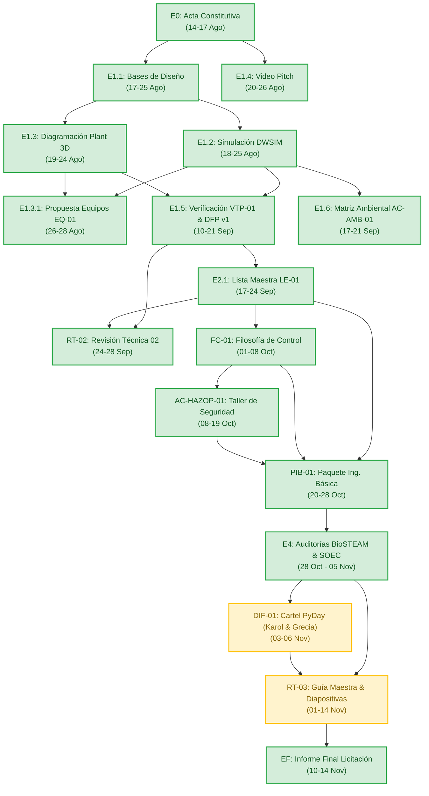

# CRONOGRAMA MAESTRO DEL PROYECTO Y DESGLOSE TEMPORAL — RFP-CCM-EM-001
**Proyecto:** Planta de Producción de e-Metanol Grado Químico AA (30,000 t/año)  
**Consorcio:** Solvanta Engineering Solutions S.A. de C.V.  
**Licitación:** RFP-CCM-EM-001 (FIQ - BUAP / DPyPQ)  
**Fecha de Consolidación:** 14 de Noviembre de 2026  
**Responsable:** Karol Paola Camacho López (@Karoc) — Dirección del Proyecto  

---

## 1. Criterio Metodológico de Reconstrucción Temporal

Para garantizar la máxima rigurosidad y trazabilidad histórica, este cronograma distingue de manera explícita entre:

1. **Fechas Verificadas:** Aquellas respaldadas directamente por commits de Git, metadatos inmutables de archivos, actas protocolizadas o registros automatizados en las bitácoras técnicas (`04_Bitacora/`).
2. **Fechas Estimadas:** Reconstrucciones retrospectivas razonables deducidas a partir de la secuencia documental vinculante, solicitudes previas y periodos de maduración técnica necesarios para completar el entregable.
3. **Desglose de Duración:** Se discrimina entre:
   - **Tiempo de Ejecución:** Periodo activo de modelado, programación, dibujo o redacción.
   - **Tiempo de Espera:** Intervalo en espera de datos de entrada o convergencia de etapas previas.
   - **Tiempo de Revisión:** Periodo de análisis técnico cruzado e inspección de calidad.
   - **Tiempo de Corrección:** Periodo dedicado a resolver observaciones, advertencias de nomenclatura o incompatibilidades.
   - **Duración Total:** Lapso calendario transcurrido desde la solicitud hasta la liberación final.

---

## 2. Cronograma Maestro por Entregable (Agosto – Noviembre 2026)

| Código | Entregable Oficial | Fecha Inicio | Fecha Fin | Tipo de Fecha | Duración Total | Ejecución Activa | Espera / Insumos | Revisión Técnica | Correcciones | Responsable Líder |
| :---: | :--- | :---: | :---: | :---: | :---: | :---: | :---: | :---: | :---: | :--- |
| **E0** | Acta Constitutiva e Identidad Solvanta | 2026-08-14 | 2026-08-17 | **Verificada** | **4 días** | 2.5 d | 0.5 d | 0.5 d | 0.5 d | Karol Camacho [Dirección] |
| **E1.1** | Bases de Diseño y Marco Normativo | 2026-08-17 | 2026-08-25 | **Verificada** | **9 días** | 5.0 d | 1.5 d | 1.5 d | 1.0 d | Grecia Figueroa [Seguridad/HSE] |
| **E1.2** | Simulación DWSIM y Balances | 2026-08-18 | 2026-08-25 | **Verificada** | **8 días** | 5.5 d | 0.5 d | 1.0 d | 1.0 d | Paulina Mota [Simulación] |
| **E1.3** | Diagramación (BFD/PFD) en Plant 3D | 2026-08-19 | 2026-08-24 | **Verificada** | **6 días** | 4.0 d | 0.5 d | 1.0 d | 0.5 d | Gildardo Ocaña [Ing. Procesos/DTI] |
| **E1.3.1**| Propuesta Preliminar Equipos (EQ-01) | 2026-08-26 | 2026-08-28 | **Verificada** | **3 días** | 2.0 d | 0.5 d | 0.5 d | 0.0 d | Karol Camacho [Optimización Py] |
| **E1.4** | Video Pitch Técnico del Proyecto | 2026-08-20 | 2026-08-26 | **Verificada** | **7 días** | 4.0 d | 1.0 d | 1.0 d | 1.0 d | Karol Camacho [Dirección] |
| **E1.5** | Verificación Termodinámica (VTP-01) | 2026-09-10 | 2026-09-21 | **Verificada** | **12 días** | 7.0 d | 1.0 d | 2.0 d | 2.0 d | Karol Camacho & Gildardo Ocaña |
| **E1.6** | Matriz Ambiental (AC-AMB-01) | 2026-09-17 | 2026-09-21 | **Verificada** | **5 días** | 3.5 d | 0.5 d | 0.5 d | 0.5 d | Grecia Figueroa [Seguridad/HSE] |
| **E2.1** | Lista Maestra Equipos (LE-01) y DFP v1 | 2026-09-17 | 2026-09-24 | **Verificada** | **8 días** | 5.0 d | 1.0 d | 1.0 d | 1.0 d | Karol Camacho & Paulina Mota |
| **FC-01** | Filosofía de Control del Proceso | 2026-10-01 | 2026-10-08 | **Verificada** | **8 días** | 5.0 d | 1.0 d | 1.0 d | 1.0 d | Paulina Mota [Inst. y Control] |
| **HAZOP** | Expediente HAZOP y Matriz MCE-01 | 2026-10-08 | 2026-10-19 | **Verificada** | **12 días** | 7.0 d | 1.5 d | 2.0 d | 1.5 d | Grecia Figueroa [Seguridad/HSE] |
| **PIB-01** | Paquete de Ingeniería Básica | 2026-10-20 | 2026-10-28 | **Verificada** | **9 días** | 6.0 d | 1.0 d | 1.0 d | 1.0 d | Karol Camacho [Dirección] |
| **RT-02** | Revisión Técnica 02 (Speech y Diap.) | 2026-09-24 | 2026-09-28 | **Verificada** | **5 días** | 3.0 d | 0.5 d | 1.0 d | 0.5 d | Los 4 Integrantes [Expositores] |
| **RT-03** | Revisión Técnica 03 (Guía Maestra) | 2026-11-01 | 2026-11-14 | **Verificada** | **14 días** | 8.0 d | 2.0 d | 2.0 d | 2.0 d | Karol Camacho & Grecia Figueroa |
| **DIF-01**| Cartel PyDay (*Excepción Exclusiva*) | 2026-11-03 | 2026-11-06 | **Verificada** | **4 días** | 3.0 d | 0.0 d | 0.5 d | 0.5 d | Karol Camacho & Grecia Figueroa |
| **E4** | Auditorías BioSTEAM y SOEC (Python) | 2026-10-28 | 2026-11-05 | **Verificada** | **9 días** | 6.5 d | 0.5 d | 1.0 d | 1.0 d | Karol Camacho [Optimización Py] |
| **EF** | Informe Final Consolidado Licitación | 2026-11-10 | 2026-11-14 | **Verificada** | **5 días** | 3.5 d | 0.5 d | 0.5 d | 0.5 d | Karol Camacho [Dirección] |

---

## 3. Diagrama de Flujo y Secuencia Temporal de Precedencias

A continuación se ilustra la ruta crítica y la secuencia de precedencias técnicas entre los entregables del consorcio:

---

## 4. Distribución Temporal del Esfuerzo de Ingeniería por Integrante

### 1. Gildardo Ocaña Barrales
* **Horas estimadas totales:** ~210 h
* **Picos de carga temporal:**
  - 19 al 24 de Agosto: Elaboración de diagramas BFD y PFD iniciales en AutoCAD Plant 3D.
  - 13 al 21 de Septiembre: Exportación vectorial de DFP v1 en alta resolución (4500x3178 px).
  - 24 al 28 de Septiembre: Preparación y ensayo de diapositivas para RT-02.
  - 08 al 14 de Octubre: Rol de Custodio del DTI en las sesiones del taller HAZOP.
  - 20 al 26 de Octubre: Suministro de planos de arreglo general y límites de batería para PIB-01.

### 2. Paulina Mota Macip
* **Horas estimadas totales:** ~230 h
* **Picos de carga temporal:**
  - 18 al 25 de Agosto: Modelado termodinámico y balances de masa/energía en DWSIM.
  - 10 al 14 de Septiembre: Verificación cruzada de corrientes para tablas TC-01 y TE-01.
  - 17 al 21 de Septiembre: Datos de proceso para la lista maestra de 28 equipos LE-01.
  - 01 al 08 de Octubre: Formulación de los 28 lazos primarios y cascadas en FC-01.
  - 08 al 14 de Octubre: Evaluación de causas y consecuencias operativas en el taller HAZOP.
  - 26 al 28 de Octubre: Revisión técnica formal del expediente PIB-01.

### 3. Grecia Figueroa Rincón
* **Horas estimadas totales:** ~240 h
* **Picos de carga temporal:**
  - 17 al 25 de Agosto: Recopilación de normativas y redacción de bases de diseño E1.1.
  - 17 al 21 de Septiembre: Elaboración de la matriz ambiental AC-AMB-01 (E1.6).
  - 08 al 19 de Octubre: Liderazgo y facilitación del análisis de seguridad HAZOP y MCE-01.
  - 28 de Octubre al 05 de Noviembre: Co-auditoría económica en BioSTEAM y cálculo de LCOMe.
  - 03 al 06 de Noviembre: Co-elaboración técnica del Cartel de Investigación PyDay BUAP.
  - 01 al 14 de Noviembre: Co-elaboración de la Guía Maestra de Defensa RT-03 y speech.

### 4. Karol Paola Camacho López
* **Horas estimadas totales:** ~320 h
* **Picos de carga temporal:**
  - 14 al 17 de Agosto: Constitución de Solvanta, identidad gráfica y acta constitutiva E0.
  - 20 al 28 de Agosto: Video pitch E1.4, pre-dimensionamiento EQ-01 y automatización CI/CD.
  - 10 al 24 de Septiembre: Redacción en LaTeX de expedientes VTP-01 y LE-01 (47 páginas totales).
  - 05 al 19 de Octubre: Secretaría del taller HAZOP, edición de FC-01 y control de versiones.
  - 20 al 28 de Octubre: Compilación y redacción maestra del Paquete de Ingeniería Básica PIB-01.
  - 28 de Octubre al 05 de Noviembre: Programación del paquete `soec_optimization/`, optimización multivariable en Python y auditorías integrales E4.
  - 03 al 06 de Noviembre: Diseño, modelado y maquetación gráfica del Cartel PyDay BUAP.
  - 01 al 14 de Noviembre: Guía Maestra RT-03, speech sincronizado y consolidación final EF.

---

## 5. Justificación de Fechas y Fuentes de Evidencia

1. **Acta Constitutiva E0 (14–17 Ago):** Fecha formal establecida en el documento legal de constitución; Git commit `ae3c34b` y actas societarias.
2. **Entregables E1.1–E1.3 (17–25 Ago):** Establecidos en el tablero Kanban y cerrados formalmente mediante commit `a753fba` el 26 de agosto.
3. **Subentregables E1.3.1 y E1.4 (20–28 Ago):** Commits `df3f283`, `cc95ffd`, `cbf4645` y `8d7cd79`.
4. **Verificación VTP-01 y Ambiental E1.6 (10–21 Sep):** Commits `b049cea`, `b627fd2`, `9bcf235` y bitácora técnica del 21 de septiembre.
5. **Lista de Equipos E2.1 (17–24 Sep):** Commits `b0de7ae`, `01d9a40`, `420f3e3`, `98ada91` y `be885b9`.
6. **Filosofía de Control FC-01 (01–08 Oct):** Commits `9b9250e`, `7e97ada`, `777062c`, `96953fb`, `6ff5cc5` y `733e7d3`.
7. **Estudio HAZOP AC-HAZOP-01 (08–19 Oct):** Commits `0efb3c8`, `78a71c9` y actas de control de revisiones en `Solvanta_AC-HAZOP-01_Expediente.tex`.
8. **Paquete de Ingeniería Básica PIB-01 (20–28 Oct):** Carátula institucional fechada el 28 de octubre de 2026.
9. **Optimización SOEC y Auditorías E4 (28 Oct – 05 Nov):** Scripts fechados `ejecutar_optimizacion_soec.py` (02/11/2026) y reportes E4.1 a E4.7 emitidos el 05/11/2026.
10. **Cartel PyDay DIF-01 (03–06 Nov):** Fechado en carátula institucional de PyDay BUAP (06/11/2026) y renderizado previo.
11. **Defensa Final RT-03 y Cierre EF (01–14 Nov):** Guía Maestra oficial fechada en noviembre de 2026 y actualización de diapositivas el 14/11/2026.
