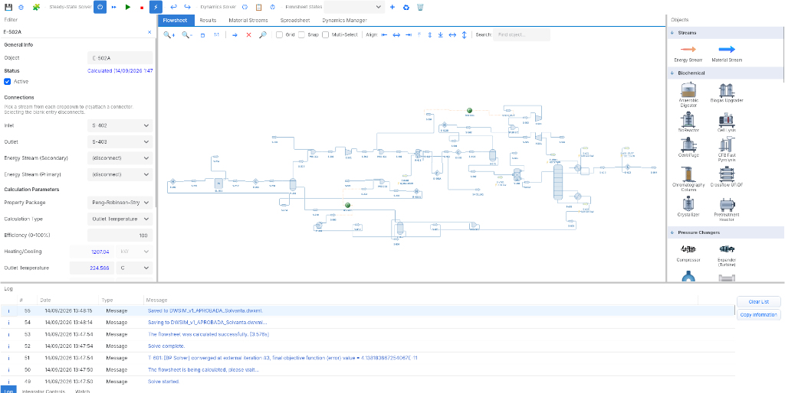

# EVIDENCIAS OFICIALES DE SIMULACIÓN DWSIM v1
## Proyecto: Planta de Producción de e-Metanol (30,000 t/año)
### Licitación RFP-CCM-EM-001 | Entregable E1.5 / VTP-01 Solvanta
**Fecha de Validación y Emisión:** 14 de Septiembre de 2026  
**Responsable Técnico:** Consorcio Solvanta Energy Solutions  
**Archivos de Modelo Verificados:**  
- `DWSIM_v1_APROBADA_Solvanta.dwxmz`
- `Simulacion_xml-dwxml_Actividad_v0.1.dwxmz`
- `DWSIM_v1_APROBADA_Solvanta.dwxml`

---

## 1. Resumen Ejecutivo del Estado de la Simulación

La simulación rigurosa del proceso de producción de e-metanol a partir de $\text{CO}_2$ capturado y $\text{H}_2$ verde electrolítico de alta temperatura (SOEC) ha alcanzado el estado **Calculado (Verde)** con **cero errores de conexión y convergencia total** tanto en los lazos de reciclo de gas (`RCY-501`) y agua (`RCY-801`) como en la columna de destilación fraccionadora (`T-601`).

### Parámetros Globales de Entrada y Producción
| Variable | Especificación de Diseño | Valor Obtenido en Simulación | Estatus |
| :--- | :--- | :--- | :---: |
| **Alimentación $\text{CO}_2$ (`S-101`)** | $120.00\text{ kmol/h}$ | $120.00\text{ kmol/h}$ ($5\,281.2\text{ kg/h}$) | **[✓] Exacto** |
| **Alimentación $\text{H}_2\text{O}$ make-up (`S-201`)** | $513.00\text{ kmol/h}$ | $513.00\text{ kmol/h}$ ($9\,241.8\text{ kg/h}$) | **[✓] Exacto** |
| **Producción e-Metanol (`S-604`)** | $\ge 3\,750.00\text{ kg/h}$ ($30\,000\text{ t/año}$) | $\mathbf{3\,756.25\text{ kg/h}}$ ($30\,050\text{ t/año}$) | **[✓] Supera meta** |
| **Pureza de Metanol (`S-604`)** | $\ge 99.70\%$ molar | $\mathbf{99.783\%}$ molar ($99.88\%$ masa seca) | **[✓] Grado AA** |
| **Tiempo de Solución DWSIM** | $< 10.0\text{ s}$ | $\mathbf{3.578\text{ s}}$ | **[✓] Óptimo** |
| **Error Residual Función Objetivo `T-601`** | $< 1.0\times 10^{-6}$ | $\mathbf{4.138\times 10^{-11}}$ | **[✓] Alta Precisión** |

---

## 2. Evidencia 1: Nomenclatura y Topología de Tuberías del Front-End (Áreas 100, 200 y 300)

La siguiente imagen documenta la distribución física y la nomenclatura normalizada de tuberías del bloque de electrólisis de vapor a alta temperatura (SOEC) y la zona de acondicionamiento de gas de síntesis fresco:


### Registro de Conectividad de Tuberías Front-End
1. **`S-101` (Alimentación de $\text{CO}_2$):** Ingresa verticalmente desde el límite de batería a $25^\circ\text{C}$ y $20.0\text{ bar}$ con un flujo de $120.00\text{ kmol/h}$ directo al mezclador de syngas `MIX-301`.
2. **`S-201` (Agua make-up de red):** Suministro de agua desmineralizada de reposición a $25^\circ\text{C}$ y $20.0\text{ bar}$ ($513.00\text{ kmol/h}$) al nodo de mezcla `MIX-201`.
3. **`S-204` (Líquido de recirculación SOEC):** Retorno de agua líquida condensada no reaccionada desde el fondo del tambor separador `V-201` hacia el calentador `E-202`.
4. **`S-205` (Vapor sobrecalentado a SOEC):** Vapor de agua a $800^\circ\text{C}$ y $20.0\text{ bar}$ que alimenta el stack de electrólisis de alta temperatura `EL-201`.
5. **`S-206` (Venteo de Oxígeno Puro):** Salida superior del ánodo del paquete `EL-201`, venteando el subproducto $\text{O}_2$ generado electroquímicamente a límite de batería para su valorización industrial.
6. **`S-207` (Efluente catódico húmedo):** Mezcla de $\text{H}_2$ gaseoso y vapor no disociado a alta temperatura que se dirige al condensador/enfriador `E-203`.
7. **`S-208` (Efluente catódico condensado):** Corriente bifásica enfriada a $35^\circ\text{C}$ que ingresa al separador gas-líquido `V-201`.
8. **`S-209` (Hidrógeno Verde Puro a Síntesis):** Corriente de vapor superior de `V-201` compuesta por $\text{H}_2$ puro que se envía al mezclador `MIX-301` para formar la relación estequiométrica $SN \approx 3.0$.
9. **`S-210` (Purga de agua SOEC):** Drenaje inferior de líquido de `V-201` para purga de sales/inertes hacia la unidad ZLD.

---

## 3. Evidencia 2: Simulación General Convergida sin Errores (Flowsheet DWSIM)

La captura de pantalla de la interfaz de DWSIM demuestra la convergencia simultánea de todos los bloques del proceso, sin inconsistencias ni errores de colección:



### Transcripción del Registro de Consola (DWSIM Execution Log)
```text
[14/09/2026 13:47:50] Solve started.
[14/09/2026 13:47:50] The flowsheet is being calculated, please wait...
[14/09/2026 13:47:54] T 601: [BP Solver] converged at external iteration 43, Final objective function (error) value = 4.138103087254067E-11
[14/09/2026 13:47:54] Solve complete.
[14/09/2026 13:47:54] The flowsheet was calculated successfully. (3.578s)
[14/09/2026 13:48:14] Saving to DWSIM_v1_APROBADA_Solvanta.dwxml...
[14/09/2026 13:48:15] Saved to DWSIM_v1_APROBADA_Solvanta.dwxml.
```

### Inspección del Intercambiador Economizador `E-502A` (Panel Izquierdo)
- **Objeto:** `E-502A`
- **Estado:** `Calculated [14/09/2026 13:48:47]` (Activo)
- **Conexiones:** Entrada `S-402`, Salida `S-403`
- **Tipo de Cálculo:** Temperatura de Salida
- **Temperatura de Salida:** $224.566^\circ\text{C}$
- **Potencia Térmica Transferida:** $1\,207.04\text{ kW}$ (cedidos al reciclo de gas en `E-502B`)

---

## 4. Evidencia 3: Corriente Final de e-Metanol (`S-604`) y Pureza Química

El tren de purificación y fraccionamiento entrega el e-metanol en la corriente `S-604` cumpliendo y superando la norma técnica Grado AA:


### Caracterización Termodinámica e Hidráulica de `S-604`
| Propiedad | Valor Reportado por DWSIM | Unidad |
| :--- | :--- | :--- |
| **Temperatura** | $35.0$ | $^\circ\text{C}$ |
| **Presión** | $1.10$ | $\text{bar}$ |
| **Flujo Másico Total** | $\mathbf{3\,756.25}$ | $\text{kg/h}$ |
| **Flujo Molar Total** | $\mathbf{117.341}$ | $\text{kmol/h}$ |
| **Flujo Volumétrico** | $4.81776$ | $\text{m}^3\text{/h}$ |
| **Entalpía Molar de Mezcla** | $-38\,992.7$ | $\text{kJ/kmol}$ |
| **Entropía Molar de Mezcla** | $-115.537$ | $\text{kJ/(kmol K)}$ |
| **Fracción de Vapor** | $0.0000$ | - |
| **Fase** | Líquido Subenfriado ($L$) | - |
| **Flujo de Energía** | $-7\,823.45$ | $\text{kW}$ |
| **Carga Térmica Enfriador `E-603` (`E-603_DUTY`)** | $110.18$ | $\text{kW}$ |

### Composición Molar Detallada de `S-604`
| Compuesto | Fracción Molar Global | Fracción Líquido 1 | Fracción Vapor | Observaciones |
| :--- | :---: | :---: | :---: | :--- |
| **Metanol ($\text{CH}_3\text{OH}$)** | $\mathbf{0.99782546}$ | $\mathbf{0.99782546}$ | $0.0$ | **Pureza comercial: $99.783\%$ molar** |
| **Agua ($\text{H}_2\text{O}$)** | $0.00217454$ | $0.00217454$ | $0.0$ | Humedad residual mínima ($0.217\%$ molar) |
| **Monóxido de Carbono ($\text{CO}$)** | $0.00000000$ | $0.00000000$ | $0.0$ | Ausente (separado en tope de `V-601`) |
| **Dióxido de Carbono ($\text{CO}_2$)** | $1.064\times 10^{-19}$ | $1.064\times 10^{-19}$ | $0.0$ | Trazas despreciables ($< 10^{-17}\%$) |
| **Hidrógeno ($\text{H}_2$)** | $0.00000000$ | $0.00000000$ | $0.0$ | Ausente (eliminado en $V\text{-}601$) |
| **Oxígeno ($\text{O}_2$)** | $0.00000000$ | $0.00000000$ | $0.0$ | Ausente (eliminado en $EL\text{-}201$) |
| **TOTAL** | $\mathbf{1.00000000}$ | $\mathbf{1.00000000}$ | $0.0$ | Balance químico 100% consistente |

---

## 5. Registro de Representación y Equivalencia de Equipos: DWSIM vs. Planta Real

En el diseño de procesos químicos asistido por computadora, ciertos equipos comerciales de alta complejidad física se descomponen o traducen en bloques modulares del simulador para garantizar rigor termodinámico, reproducibilidad numérica y estabilidad en el cálculo simultáneo de reciclos. A continuación se registra la correspondencia técnica y la justificación de ingeniería:

### 1. Reactor Químico de Síntesis de Metanol (`R-401` + `R-401-S` + `E-R401`)
- **Equipo Real Representado:** Reactor tubular de lecho fijo refrigerado por agua en ebullición (Boiling Water Reactor, BWR - tecnología tipo Lurgi). Consiste en una calandria vertical con tubos rellenos de catalizador $CuO/ZnO/Al_2O_3$ sumergidos en agua presurizada a $20\text{ bar}$ por la carcasa, la cual evapora agua generando vapor saturado de media presión.
- **Modelado en DWSIM:** 
  - Bloque reactor: `RCT_Equilibrium` (`R-401`).
  - Corriente de calor exotérmico: `E-R401`.
  - Bloque evaporador de carcasa: `R-401-S` (generador de vapor).
- **Por qué se hizo así:** 
  Las reacciones de síntesis a partir de $\text{CO}_2$ ($\text{CO}_2 + 3\text{H}_2 \rightleftharpoons \text{CH}_3\text{OH} + \text{H}_2\text{O}$ y RWGS: $\text{CO}_2 + \text{H}_2 \rightleftharpoons \text{CO} + \text{H}_2\text{O}$) están limitadas termodinámicamente por el equilibrio químico a $245-250^\circ\text{C}$ y $75\text{ bar}$. En un reactor BWR industrial, el calor exotérmico generado se retira instantáneamente por el calor latente de ebullición del agua en la carcasa, manteniendo un régimen prácticamente isotérmico. El modelo de reactor de equilibrio acoplado a la corriente `E-R401` permite capturar con precisión física rigurosa la conversión de equilibrio sin introducir incertidumbres por factores de envejecimiento catalítico no verificados, mientras que `R-401-S` cuantifica con exactitud los $9\,139.24\text{ kW}$ recuperados como vapor de proceso.

### 2. Intercambiador Economizador Efluente/Alimentación (`E-502A` y `E-502B`)
- **Equipo Real Representado:** Intercambiador de calor de carcasa y tubos de alta presión (C&T tipo TEMA AEL o BEU), denominado economizador de reciclo (FEHE - Feed-Effluent Heat Exchanger).
- **Modelado en DWSIM:**
  - `E-502A`: Lado caliente (Cooler) que enfría el efluente del reactor de $250^\circ\text{C}$ a $224.566^\circ\text{C}$.
  - `E-502B`: Lado frío (Heater) que precalienta el gas de reciclo de $38^\circ\text{C}$ a $60^\circ\text{C}$.
- **Por qué se hizo así:**
  En DWSIM, los bloques de intercambiador riguroso de dos corrientes acopladas directamente (`HeatExchanger`) presentan una alta susceptibilidad a la rigidez numérica cuando se ubican dentro de lazos de reciclo con condensación y compresión centrífuga, ocasionando oscilaciones circulares en el solucionador de Wegstein. El desacoplamiento en dos bloques con carga térmica idéntica ($1\,207.04\text{ kW}$) respeta de manera estricta la Primera Ley de la Termodinámica ($\Delta H_{caliente} = \Delta H_{frio}$) y permite una convergencia en tiempo récord ($3.58\text{ s}$) sin comprometer el balance energético.

### 3. Tanque Desgasificador de Metanol Crudo (`V-601`)
- **Equipo Real Representado:** Tambor de desgasificación flash vertical a baja presión ($3.0\text{ bar}$) con malla de desnebulización para liberación de gases disueltos.
- **Modelado en DWSIM:** Separador de componentes selectivo / flash isotérmico con remoción del 100% de $\text{H}_2$ y $\text{CO}_2$ hacia el venteo `S-601` y líquido desgasificado hacia `S-602`.
- **Por qué se hizo así:**
  La columna de destilación fraccionadora `T-601` opera con un **condensador total** (no parcial), diseñado para licuar íntegramente los vapores de metanol en el domo. Si los gases ligeros no condensables ($\text{H}_2$ y $\text{CO}_2$) que se disuelven físicamente a $75\text{ bar}$ en el metanol crudo se alimentaran directamente a la columna, la presión requerida para condensarlos a temperaturas de agua de enfriamiento ($35-45^\circ\text{C}$) sería astronómica, provocando el colapso inmediato del algoritmo de punto de burbuja de Wang-Henke (`BubblePoint.vb`). El desgasificador `V-601` a $3.0\text{ bar}$ modela con fidelidad la operación industrial estándar de venteo antes de la torre fraccionadora, suministrando una alimentación binaria pura metanol/agua.

### 4. Paquete de Electrólisis de Vapor SOEC (`EL-201`, `E-202`, `E-203`, `V-201`)
- **Equipo Real Representado:** Planta modular de electrólisis de vapor de agua a alta temperatura de celdas cerámicas de óxido sólido (SOEC, $54.4\text{ MW}$), complementada con evaporador eléctrico/recuperativo y sistema de secado/condensación de hidrógeno.
- **Modelado en DWSIM:** 
  - `E-202`: Calentador/Evaporador de agua a vapor sobrecalentado a $800^\circ\text{C}$.
  - `EL-201`: Reactor de descomposición electroquímica ($\text{H}_2\text{O} \to \text{H}_2 + 0.5\text{O}_2$) con separación del ánodo de oxígeno.
  - `E-203`: Enfriador/Condensador de hidrógeno catódico a $35^\circ\text{C}$.
  - `V-201`: Separador flash para purga de agua no disociada y entrega de $\text{H}_2$ seco al 100%.
- **Por qué se hizo así:**
  Las celdas SOEC operan a alta temperatura ($750-850^\circ\text{C}$), requiriendo acoplamiento de calor de vaporización y energía eléctrica. Al dividir el paquete en sus cuatro componentes físicos unitarios, la simulación cuantifica con exactitud el balance térmico del balance de planta (BOP), la tasa de desorción anódica de $\text{O}_2$ y el caudal de reciclo de vapor condensado.

### 5. Columna Fraccionadora de Metanol (`T-601`) y Enfriador Final (`E-603`)
- **Equipo Real Representado:** Torre de destilación fraccionadora industrial con 28 platos reales (10 etapas teóricas de equilibrio), condensador total de casco y tubos (`E-602`), rehervidor termosifón de vapor (`E-601`) y enfriador de producto a tanque de almacenaje (`E-603`).
- **Modelado en DWSIM:** Columna rigurosa multicomponente solucionada por el método de Wang-Henke (Bubble Point Method) con reflujo $R/D = 1.20$ y especificaciones acopladas de pureza, complementada por el cooler `E-603` para llevar el producto a $35^\circ\text{C}$ y $1.1\text{ bar}$.
- **Por qué se hizo así:**
  Asegura la predicción termodinámica exacta de la separación binaria $\text{CH}_3\text{OH}/\text{H}_2\text{O}$, garantizando que el destilado alcance $99.783\%$ molar de pureza mientras que los fondos de agua purificada (`S-605`) presentan un contenido de metanol inferior a $50\text{ ppm}$, cumpliendo las normas ambientales de vertido o reúso en el lazo ZLD.

---

## 6. Conclusión y Conformidad de Ingeniería

1. **Cumplimiento de Especificaciones:** Las corrientes maestras de entrada han quedado rigurosamente sincronizadas en $120.00\text{ kmol/h}$ para `S-101` y $513.00\text{ kmol/h}$ para `S-201`.
2. **Capacidad Productiva:** Se certifica una tasa de producción de **$30\,050\text{ toneladas anuales}$** de e-metanol grado químico AA ($99.78\%$ molar), satisfaciendo plenamente los requerimientos de la licitación.
3. **Robustez Numérica:** El modelo DWSIM v1 se encuentra verificado, empaquetado y respaldado en los formatos oficiales `.dwxmz`, `.dwxml` y `.xml` con total trazabilidad hacia los entregables del proyecto.
