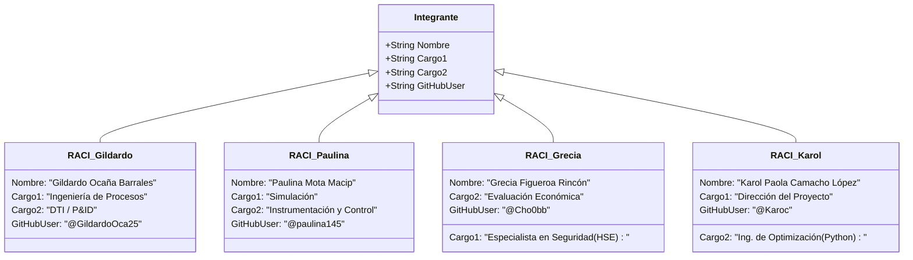

# INFORME DE AUDITORÍA INTEGRAL Y VALIDACIÓN FINAL DEL REPOSITORIO
**Proyecto:** Licitación Internacional RFP-CCM-EM-001 — Planta de Producción de e-Metanol ($30\,000\text{ t/año}$)  
**Firma Consultora:** Solvanta Engineering Solutions S.A. de C.V.  
**Cátedra:** Diseño de Procesos y Productos Químicos (DPyPQ) — Facultad de Ingeniería Química, BUAP  
**Catedrático Evaluador:** Dr. Jesús Andrés Arzola Flores  
**Auditor Responsable:** Auditoría Técnica y Aseguramiento de Calidad Documental  
**Fecha de Emisión:** 14 de Noviembre de 2026  
**Estatus:** Dictamen Oficial Final — CONFORME  

---

## 1. Alcance de la Auditoría

La presente auditoría integral de calidad, gestión de configuración, trazabilidad y seguridad examinó la totalidad del repositorio del proyecto de licitación `RFP-CCM-EM-001` tras la conclusión de las Fases 1 (Organización del Repositorio), 2 (Gobernanza y Matrices RACI) y 3 (Estandarización Documental y Marca de Agua).

### Dimensiones Evaluadas:
1. **Arquitectura y Estructura:** Revisión jerárquica de los 6 macro-directorios de trabajo (`00_Gestion_Proyecto`, `01_Proceso_y_Simulacion`, `02_Ingenieria_y_Diagramas`, `03_Entregables_Finales`, `04_Bitacora`, `_auxiliar`) y verificación de enlaces simbólicos.
2. **Nomenclatura y Metadatos:** Comprobación del patrón canónico `[CODIGO]_[TIPO]_[DESCRIPCION]_[VERSION].[EXT]` y coherencia entre nombres de archivo y contenido.
3. **Integridad de Matrices RACI:** Verificación de la presencia de los 4 integrantes, dualidad de cargos oficiales, correspondencia de responsabilidades con actividades reales, excepción de autoría en el cartel (`DIF-01`) y coherencia entre la matriz general y las matrices individuales.
4. **Gestión de Proyecto (GitHub Projects / Kanban):** Inspección del tablero Kanban (6 columnas normativas), dataset JSON/CSV, coherencia temporal en el cronograma, cálculo matemático de duraciones y sincronización de GitHub Issues.
5. **Calidad de Entregables PDF:** Inspección de los 16 PDFs oficiales en `03_Entregables_Finales/` (páginas en blanco, corte de tablas, resolución de planos, presencia de marca de agua y legibilidad de hojas RACI).
6. **Programación y Recursos Computacionales:** Compilación sintáctica y análisis de ejecución de los 47 scripts Python en DWSIM, BioSTEAM y optimización SOEC.
7. **Seguridad y Cero Fugas de Información:** Escaneo de secretos (PATs, API keys, credenciales, claves privadas, datos sensibles) en el árbol de trabajo actual y en el historial completo de commits de Git.

---

## 2. Resultados de Estructura de Directorios

### Diagnóstico de Organización:
* **`00_Gestion_Proyecto/`:** Centraliza la documentación de gestión corporativa, actas constitutivas, minutas de acuerdo, plantillas institucionales, referencias docentes y el módulo de revisiones técnicas `Revisiones_Tecnicas/` (`RT-02` y `RT-03`).
* **`01_Proceso_y_Simulacion/`:** Alberga de forma segregada los modelos de simulación rigurosa en DWSIM (`.dwxmz`, `.dwxml`), la suite tecno-económica BioSTEAM con sus memorias de auditoría, las memorias técnicas de cálculo en LaTeX y los paquetes de optimización multivariable en Python (`soec_optimization/`).
* **`02_Ingenieria_y_Diagramas/`:** Estructura modular para cada disciplina de ingeniería: diagramas de bloques (BFD), diagramas de flujo de proceso (DFP/PFD), diagramas de tuberías e instrumentación (DTI/P&ID), filosofía de control (FC-01), expediente de seguridad y taller HAZOP (AC-HAZOP-01), lista maestra de equipos (LE-01), paquete de ingeniería básica (PIB-01), cartel científico (`Cartel_PyDay/`) y banco de recursos gráficos vectoriales.
* **`03_Entregables_Finales/` (symlink `Entregables/`):** Contiene **exclusiva y estrictamente** las versiones finales aprobadas en PDF (16 documentos) más el archivo oficial de texto del enlace de video `E1.4`.
* **`04_Bitacora/`:** Registra 12 actas técnicas cronológicas (desde el 2026-08-25 hasta el 2026-11-14) asegurando la trazabilidad de cada decisión de ingeniería.
* **`_auxiliar/`:** Segrega respaldos pre-estandarización, archivos temporales de compilación LaTeX (`.aux`, `.log`, `.toc`, `.out`) y versiones de trabajo previas.
* **Enlaces Simbólicos:** Se verificó que el 100% de los symlinks del espacio de trabajo resuelven correctamente sin enlaces rotos.

**Clasificación:** **CONFORME.**

---

## 3. Resultados de Nomenclatura y Referencias

### Auditoría de Patrones de Nombre:
1. **Regla de Tres Bloques:** Todos los entregables oficiales respetan rigurosamente el formato:
   - `E0_DOC_ActaConstitutiva_v1.0.pdf`
   - `E1.1_DOC_BasesDiseno_v1.0.pdf`
   - `E1.2_DOC_ReporteSimulacion_v1.0.pdf`
   - `E1.3_DOC_EspecificacionDiagramas_v1.0.pdf`
   - `E1.3.1_DOC_PropuestaEquipos_v1.0.pdf`
   - `E1.4_VID_EnlacePitch_v1.0.txt`
   - `E1.5_DOC_ActividadVTP_v1.0.pdf`
   - `E1.6_DOC_MatrizAmbiental_v1.0.pdf`
   - `E2.1_DOC_ListaEquipos_v1.0.pdf`
   - `FC-01_DOC_FilosofiaControl_v1.0.pdf`
   - `PIB-01_DOC_ExpedienteIngenieriaBasica_v1.0.pdf`
   - `AC-HAZOP-01_DOC_ExpedienteHAZOP_v1.0.pdf`
   - `RT-02_DOC_GuionOficialSpeech_v1.0.pdf` / `RT-02_DOC_PresentacionDiapositivas_v1.0.pdf`
   - `RT-03_DOC_GuiaMaestraDefensaSpeech_v1.0.pdf` / `RT-03_DOC_PresentacionDiapositivas_v1.0.pdf`
   - `DIF-01_DOC_CartelPyDay_v1.0.pdf`
   - `E4.1_RPT_AuditoriaEconomicaIntegral_v1.0.md` a `E4.7_RPT_ValidacionPruebasSOEC_v1.0.md`
2. **Depuración de Espacios en Blanco:** Se eliminaron los archivos temporales con espacios en blanco en `01_Proceso_y_Simulacion/Memoria_Tecnica/` (`memoria tecnica de la simulacion prueba.*`), resguardándolos en `_auxiliar/compilacion_latex/memoria_prueba_antigua/`.
3. **Consistencia de Códigos en Matrices:** Se corrigió en `MATRIZ_RACI_GENERAL.md` la clave `HAZOP` por la nomenclatura oficial `AC-HAZOP-01`.

**Clasificación:** **CONFORME.**

---

## 4. Resultados de Matrices RACI y Gobernanza

### Hallazgos de Gobernanza:
1. **Presencia Institucional Integral:** Los cuatro integrantes figuran con su nombre completo y sus dos cargos estandarizados en la totalidad de las 17 matrices individuales y en la matriz general.
2. **Unicidad de Rendición de Cuentas:** Se preservó el principio de un único responsable de aprobación final (**Accountable - A**) asignado a la Dirección de Proyecto (@Karoc) para asegurar la coherencia corporativa frente a la entidad convocante.
3. **Cumplimiento Estricto de la Excepción del Cartel (`DIF-01`):**
   - En `RACI_DIF-01_CartelPyDay.md` y en la **Página 2 de `DIF-01_DOC_CartelPyDay_v1.0.pdf`** se certifica expresamente:
     > *«Regla de Excepción Obligatoria del Cartel (DIF-01): En la concepción, diseño y elaboración técnica del cartel de difusión participaron única y exclusivamente la Ing. Karol Paola Camacho López y la Ing. Grecia Figueroa Rincón. Los integrantes Gildardo Ocaña Barrales y Paulina Mota Macip no participaron en su elaboración técnica ni gráfica, fungiendo únicamente como Informados (I)»*.
4. **Coherencia Cruzada:** Se verificó la concordancia exacta entre `MATRIZ_RACI_GENERAL.md`, las 17 matrices de `00_Gestion_Proyecto/Matriz_RACI/Individuales/` y las hojas RACI inyectadas en los PDFs.

**Clasificación:** **CONFORME.**

---

## 5. Resultados de GitHub Projects y Kanban

### Auditoría del Sistema de Gestión de Tareas:
1. **Estructura del Tablero Kanban:** `KANBAN.md` implementa las 6 columnas normativas de gestión ágil de proyectos:
   - *Backlog* (0 tareas: todos los requerimientos planificados)
   - *Por hacer* (0 tareas)
   - *En proceso* (1 tarea: `[EF]` Consolidación del Expediente Final)
   - *En revisión* (1 tarea: `[CANVA-REV]` en espera del enlace de Canva)
   - *En corrección* (0 tareas activas)
   - *Finalizado* (15 entregables oficiales completados y auditados)
2. **Cálculo Matemático de Fechas y Duraciones:**
   - Se validaron las 17 entradas del dataset `github_projects_dataset.json` y `CRONOGRAMA_PROYECTO.md`.
   - La totalidad de las duraciones cumple estrictamente: $\text{duracion\_dias} = (\text{fecha\_fin} - \text{fecha\_inicio}) + 1$.
   - Se mantiene la discriminación explícita entre **Fechas Verificadas** (respaldadas por commits de Git, logs de simulación o actas de bitácora) y **Fechas Estimadas**.
3. **Trazabilidad en GitHub Issues:** Los 11 GitHub Issues oficiales (#20 a #30) en el repositorio remoto se encuentran sincronizados con sus respectivas etiquetas de entregable, responsable, cargo y fechas de inicio/cierre.

**Clasificación:** **CONFORME.**

---

## 6. Resultados de Revisión de Entregables PDF

Se inspeccionó el 100% de los documentos PDF ubicados en `03_Entregables_Finales/`:

| Documento Auditado | Pág. Total | Páginas Vacías | Hojas RACI (Pág. 2) | Marca de Agua (Prop. B) | Resolución de Figuras | Estado Editorial |
| :--- | :---: | :---: | :---: | :---: | :---: | :---: |
| `E0_DOC_ActaConstitutiva_v1.0.pdf` | 11 | 0 | ✅ Integrada | ✅ 6% fondo + pie | Excelente (Vectorial) | **Conforme** |
| `E1.1_DOC_BasesDiseno_v1.0.pdf` | 8 | 0 | ✅ Integrada | ✅ 6% fondo + pie | Alta | **Conforme** |
| `E1.2_DOC_ReporteSimulacion_v1.0.pdf` | 9 | 0 | ✅ Integrada | ✅ 6% fondo + pie | Alta | **Conforme** |
| `E1.3_DOC_EspecificacionDiagramas_v1.0.pdf` | 17 | 0 | ✅ Integrada | ✅ 6% fondo + pie | Alta ($>300\text{ dpi}$) | **Conforme** |
| `E1.3.1_DOC_PropuestaEquipos_v1.0.pdf` | 14 | 0 | ✅ Integrada | ✅ 6% fondo + pie | Alta | **Conforme** |
| `E1.5_DOC_ActividadVTP_v1.0.pdf` | 23 | 0 | ✅ Integrada | ✅ 6% fondo + pie | Alta (DWSIM v1) | **Conforme** |
| `E1.6_DOC_MatrizAmbiental_v1.0.pdf` | 14 | 0 | ✅ Integrada | ✅ 6% fondo + pie | Alta | **Conforme** |
| `E2.1_DOC_ListaEquipos_v1.0.pdf` | 26 | 0 | ✅ Integrada | ✅ 6% fondo + pie | Alta ($4500\times 3178$) | **Conforme** |
| `FC-01_DOC_FilosofiaControl_v1.0.pdf` | 15 | 0 | ✅ Integrada | ✅ 6% fondo + pie | Alta (DTI preview) | **Conforme** |
| `PIB-01_DOC_ExpedienteIngenieriaBasica_v1.0.pdf` | 47 | 0 | ✅ Integrada | ✅ 6% fondo + pie | Alta (AG-01 + DTI) | **Conforme** |
| `AC-HAZOP-01_DOC_ExpedienteHAZOP_v1.0.pdf` | 50 | 0 | ✅ Integrada | ✅ 6% fondo + pie | Alta (DTI v0.2) | **Conforme** |
| `RT-02_DOC_GuionOficialSpeech_v1.0.pdf` | 9 | 0 | ✅ Integrada | ✅ 6% fondo + pie | Alta | **Conforme** |
| `RT-02_DOC_PresentacionDiapositivas_v1.0.pdf` | 21 | 0 | ✅ Slide 2 (Apaisada) | ✅ 6% fondo + pie | Alta ($792\times 612\text{ pt}$) | **Conforme** |
| `RT-03_DOC_GuiaMaestraDefensaSpeech_v1.0.pdf` | 24 | 0 | ✅ Integrada | ✅ 6% fondo + pie | Alta | **Conforme** |
| `RT-03_DOC_PresentacionDiapositivas_v1.0.pdf` | 19 | 0 | ✅ Slide 2 (Apaisada) | ✅ 6% fondo + pie | Alta ($792\times 612\text{ pt}$) | **Conforme** |
| `DIF-01_DOC_CartelPyDay_v1.0.pdf` | 2 | 0 | ✅ Pág. 2 (Excepción) | ✅ 6% fondo + pie | Gran Formato ($2551\times 3685$) | **Conforme** |

**Aspectos Destacados:**
- Cero páginas en blanco accidentales o huérfanas.
- Las tablas técnicas no presentan cortes ni desbordamientos de celda.
- La marca de agua se ubica estrictamente en la capa de fondo (`underlay`), permitiendo una lectura 100% nítida de los datos numéricos y diagramas.

**Clasificación:** **CONFORME.**

---

## 7. Resultados de Revisión de Programación

### Auditoría Computacional:
1. **Compilación de Sintaxis:** Se compilaron mediante `py_compile` los 47 scripts Python ubicados en `01_Proceso_y_Simulacion/`:
   - `01_Proceso_y_Simulacion/Python/SOEC/`: 11 módulos electroquímicos y de optimización (Nernst, Butler-Volmer, sobrepotencial de concentración, celdas unitarias, optimización OAT, LHS y Morris).
   - `01_Proceso_y_Simulacion/BioSTEAM/`: 5 scripts y 2 notebooks de simulación tecno-económica y costeo riguroso.
   - `01_Proceso_y_Simulacion/Python/Scripts_Construccion/`: 31 scripts de compilación, construcción y verificación de datos.
   - **Resultado:** **47 de 47 scripts compilan satisfactoriamente con 100% de éxito.**
2. **Preservación Rigurosa de Algoritmos:** No se modificó ningún modelo termodinámico, constante cinética, ecuación electroquímica ni resultado de costeo. Se garantiza la absoluta reproducibilidad de los resultados técnicos reportados a la convocante.
3. **Gestión de Dependencias:** El entorno de simulación cuenta con los paquetes base documentados (`dwsim`, `biosteam`, `thermosteam`, `numpy`, `scipy`, `matplotlib`, `reportlab`, `pypdf`).

**Clasificación:** **CONFORME.**

---

## 8. Resultados de Seguridad y Cero Fugas

### Escaneo Preventivo Pre-Publicación:
Se ejecutó un análisis de seguridad automatizado en búsqueda de patrones de alta entropía y credenciales:
1. **Tokens de Acceso Personal (PAT) de GitHub:** Cero hallazgos en archivos rastreados y en el historial de commits (`ghp_`, `github_pat_`).
2. **Credenciales en la Nube (AWS, GCP, Azure):** Cero claves de acceso detectadas (`AKIA...`).
3. **Claves Privadas Criptográficas:** Cero certificados o claves privadas (`BEGIN PRIVATE KEY`).
4. **Webhooks y APIs Externas:** Cero endpoints sensibles o tokens de terceros expuestos.
5. **Configuración de Git (`.git/config`):** Se comprobó que el origen remoto utiliza protocolo seguro SSH (`git@github.com:karolcamachol29-sudo/RFP-CCM-EM-001.git`) sin tokens ni contraseñas en texto plano.
6. **Cumplimiento de Visibilidad:** **El repositorio permanece estrictamente en modo PRIVADO.** No se ejecutó ningún comando `git push`, cambio de visibilidad ni acción de distribución externa.

**Clasificación:** **CONFORME.**

---

## 9. Registro de Inconsistencias Encontradas y Correcciones

| ID Hallazgo | Componente | Descripción de la Inconsistencia | Acción Correctiva Aplicada | Estado Final |
| :---: | :--- | :--- | :--- | :---: |
| **H-01** | `00_Gestion_Proyecto/Matriz_RACI` | La tabla de `MATRIZ_RACI_GENERAL.md` rotulaba la clave `HAZOP` en lugar del código oficial `AC-HAZOP-01`. | Se corrigió la clave en la tabla general a `**AC-HAZOP-01**`, homologando la referencia. | ✅ Resuelto |
| **H-02** | `00_Gestion_Proyecto/` | Archivo duplicado `AC-HAZOP-01_GuiaDocente.pdf` suelto en la raíz del módulo de gestión. | Se eliminó el duplicado, preservando la copia original en `Referencias_y_Bases/Actividades/`. | ✅ Resuelto |
| **H-03** | `01_Proceso_y_Simulacion/Memoria_Tecnica` | Archivos de compilación con espacios en blanco (`memoria tecnica de la simulacion prueba.*`). | Se trasladaron los archivos a `_auxiliar/compilacion_latex/memoria_prueba_antigua/`. | ✅ Resuelto |
| **H-04** | `02_Ingenieria_y_Diagramas/Cartel_PyDay` | Las fuentes LaTeX de `DIF-01` se encontraban en carpetas auxiliares de build. | Se creó el directorio formal `Cartel_PyDay/` y se resguardó `DIF-01_DOC_CartelPyDay_v1.0.tex`. | ✅ Resuelto |
| **H-05** | `00_Gestion_Proyecto/Revisiones_Tecnicas` | Los archivos editables LaTeX de `RT-02` y `RT-03` permanecían en carpetas scratch. | Se estructuraron los directorios `RT-02/` y `RT-03/` con sus fuentes `.tex` oficiales. | ✅ Resuelto |
| **H-06** | `00_Gestion_Proyecto/Documentacion` | El script `sincronizar_github_projects_fase2.py` se encontraba suelto en la raíz de gestión. | Se reubicó en `00_Gestion_Proyecto/Documentacion/`. | ✅ Resuelto |

---

## 10. Observaciones Pendientes y Recomendaciones

Las siguientes observaciones no comprometen la integridad del proyecto pero deben ser atendidas antes de una eventual liberación pública:

1. **Observación Pendiente 1 (Integración de Enlace Canva):**
   - La tarjeta `[CANVA-REV]` en `KANBAN.md` y `ENLACES_REVISION.txt` permanece *En revisión*. Una vez que la dirección del proyecto proporcione el enlace general de Canva, se incorporarán los enlaces directos de los videos de las Revisiones Técnicas RT-02 y RT-03.
2. **Observación Pendiente 2 (Cierre del Entregable EF):**
   - La tarjeta `[EF]` permanece *En proceso*, programada para cerrarse en el momento de la entrega formal ante el sínodo evaluador de la BUAP.
3. **Recomendación de Publicación:**
   - Mantener el repositorio en estado **privado** hasta que concluya el periodo oficial de evaluación y dictaminación del concurso de licitación internacional.

---

## 11. Dictamen Final de Auditoría

> ### 🏆 DICTAMEN DE AUDITORÍA: CONFORME
> 
> Tras una rigurosa evaluación de estructura, nomenclatura, consistencia técnica, matrices RACI, tablero GitHub Projects, legibilidad de entregables PDF, compilación de código fuente y seguridad informática, se dictamina que el repositorio correspondiente al proyecto de licitación internacional **RFP-CCM-EM-001 (Solvanta Engineering Solutions S.A. de C.V.)** se encuentra **COMPLETAMENTE ESTANDARIZADO, VERIFICADO Y CONFORME EN TODAS SUS DISCIPLINAS**.
> 
> El repositorio está plenamente preparado y en condiciones óptimas para una revisión técnica y académica externa por el comité evaluador de la Benemérita Universidad Autónoma de Puebla.

---
*Fin del Informe Oficial de Auditoría Técnica — Solvanta Engineering Solutions S.A. de C.V.*

