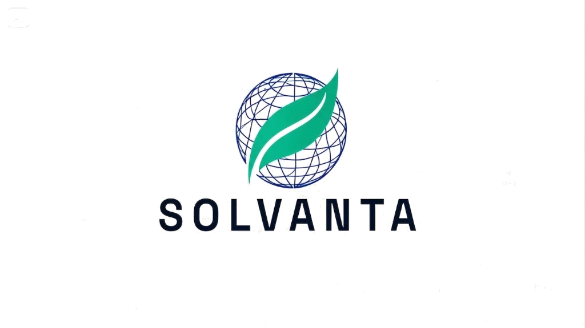

# Solvanta Engineering Solutions — RFP-CCM-EM-001

<div align="center">



### Licitación Internacional RFP-CCM-EM-001
**Planta de Producción de e-Metanol Grado Químico AA (30,000 t/año) a partir de CO2 Capturado y H2 Verde (Celdas SOEC)**

[](https://github.com/Karoc/RFP-CCM-EM-001/actions)
[](03_Entregables_Finales/)
[](00_Gestion_Proyecto/Matriz_RACI/MATRIZ_RACI_GENERAL.md)
[](01_Proceso_y_Simulacion/)
[](INFORME_AUDITORIA_FINAL.md)

</div>

---

## 1. Resumen Ejecutivo del Proyecto

El consorcio licitante **Solvanta Engineering Solutions S.A. de C.V.** presenta el expediente técnico de ingeniería para el concurso licitatorio internacional **RFP-CCM-EM-001**, convocado por la entidad **Circular Carbon México, S.A. de C.V.** (evaluado bajo el marco institucional de la Cátedra de Diseño de Procesos y Productos Químicos de la Facultad de Ingeniería Química, BUAP).

El proyecto comprende el diseño conceptual, básico y de detalle para una planta química con capacidad nominal de **30,000 toneladas métricas anuales** de e-metanol grado químico comercial AA (pureza $\ge 99.85\%$ p/p). La arquitectura tecnológica integra:
- **Electrólisis SOEC de Alta Temperatura (EL-201):** Operación a 800 °C y 20 bar con vapor sobrecalentado y recuperación térmica de efluentes, alcanzando una demanda específica de 32.92 kWh/kg H2 en el Escenario D Óptimo.
- **Compresión y Síntesis Catalítica (R-401):** Reactor tubular multitubular tipo Lurgi acoplado a caldera generadora de vapor saturado a 20 bar (R-401-S), operando a 75 bar y 245 °C sobre catalizador comercial Cu/ZnO/Al2O3 con módulo estequiométrico $M = 2.05$.
- **Separación Flash y Fraccionamiento de Alta Pureza (V-501, T-601):** Tren de condensación, flash de alta presión con turboexpansor criogénico de purga (EXP-501, recuperación de 437.8 kW), desgasificación a baja presión y columna de destilación de 34 platos con reflujo térmicamente optimizado.
- **Seguridad Operativa y Filosofía SIS:** Estudio HAZOP integral sobre 10 nodos de proceso (42 desviaciones analizadas), Matriz Causa-Efecto MCE-01 Rev. 1, 12 cambios de ingeniería incorporados en el plano maestro P&ID DTI v1.0 y cuatro interbloqueos instrumentados de seguridad mayores (I-01 a I-04, consolidados en 10 interlocks I-01 a I-10 en la matriz MI-01).

---

## 2. Consorcio y Gobernanza Técnica (Matriz RACI)

El equipo de ingeniería opera bajo asignación dual de cargos con estricta gobernanza técnica:

| Integrante | GitHub | Cargo Oficial 1 | Cargo Oficial 2 | Responsabilidad Líder en Licitación |
| :--- | :---: | :--- | :--- | :--- |
| **Karol Paola Camacho López** | `@Karoc` | Dirección del Proyecto | Ingeniera de Optimización (Python) | Coordinación ejecutiva, modelado SOEC en Python, expediente PIB-01 y cierre licitatorio. |
| **Gildardo Ocaña Barrales** | `@GildardoOca25` | Ingeniería de Procesos | Custodio DTI / Plant 3D | Modelado de diagramas BFD/DFP, diseño AutoCAD Plant 3D 2025, plano maestro DTI v1.0 y layout general. |
| **Paulina Mota Macip** | `@paulina145` | Simulación de Procesos | Instrumentación y Control | Modelado termodinámico en DWSIM v10, balances de masa/energía, Filosofía de Control FC-01 y sintonización. |
| **Grecia Figueroa Rincón** | `@Cho0bb` | Seguridad y HSE | Evaluación Económica | Estudio HAZOP, matriz Causa-Efecto MCE-01, matriz ambiental AC-AMB-01, análisis CAPEX/OPEX en BioSTEAM. |

---

## 3. Catálogo Maestro de Entregables Oficiales

Todos los documentos formales se encuentran centralizados en [`03_Entregables_Finales/`](03_Entregables_Finales/) en versiones definitivas PDF, incorporando la hoja de gobernanza RACI en la página 2 y la marca de agua institucional de documento controlado.

### Fase 0: Constitución e Identidad
* [`E0_DOC_ActaConstitutiva_v1.0.pdf`](03_Entregables_Finales/E0_Constitucion/E0_DOC_ActaConstitutiva_v1.0.pdf): Acta constitutiva, estatutos de gobernanza, poderes y organigrama formal de la firma Solvanta Engineering Solutions S.A. de C.V.

### Fase 1: Bases de Diseño, Verificación y Diagnóstico
* [`E1.1_DOC_BasesDiseno_v1.0.pdf`](03_Entregables_Finales/E1_Bases_y_Verificacion/E1.1_DOC_BasesDiseno_v1.0.pdf): Bases y criterios de diseño del proceso (NB-01), especificaciones de reactivos y productos, y marco normativo internacional.
* [`E1.2_DOC_ReporteSimulacion_v1.0.pdf`](03_Entregables_Finales/E1_Bases_y_Verificacion/E1.2_DOC_ReporteSimulacion_v1.0.pdf): Memoria técnica de simulación rigurosa en DWSIM v10, paquetes termodinámicos Peng-Robinson y balances de materia y energía.
* [`E1.3_DOC_EspecificacionDiagramas_v1.0.pdf`](03_Entregables_Finales/E1_Bases_y_Verificacion/E1.3_DOC_EspecificacionDiagramas_v1.0.pdf): Especificación y memoria de diagramas de bloques (BFD) y diagramas de flujo de proceso (PFD/DFP) en Plant 3D.
* [`E1.3.1_DOC_PropuestaEquipos_v1.0.pdf`](03_Entregables_Finales/E1_Bases_y_Verificacion/E1.3.1_DOC_PropuestaEquipos_v1.0.pdf): Catálogo preliminar de equipos de proceso (EQ-01), parámetros de diseño preliminar y clasificación por áreas.
* [`E1.4_VID_EnlacePitch_v1.0.pdf`](03_Entregables_Finales/E1_Bases_y_Verificacion/E1.4_VID_EnlacePitch_v1.0.pdf): Certificado oficial y enlace al Video Pitch Técnico de la propuesta técnica con desglose de los 4 segmentos de defensa.
* [`E1.5_DOC_ActividadVTP_v1.0.pdf`](03_Entregables_Finales/E1_Bases_y_Verificacion/E1.5_DOC_ActividadVTP_v1.0.pdf): Expediente de Verificación Termodinámica de Proceso (VTP-01), validación de propiedades y plano DFP v1 oficial.
* [`E1.6_DOC_MatrizAmbiental_v1.0.pdf`](03_Entregables_Finales/E1_Bases_y_Verificacion/E1.6_DOC_MatrizAmbiental_v1.0.pdf): Evaluación de impacto ambiental integral (AC-AMB-01), balance hídrico ZLD, huella de carbono y cumplimiento STPS/SEMARNAT.

### Fase 2: Ingeniería Básica, Control y Seguridad
* [`PIB-01_DOC_ExpedienteIngenieriaBasica_v1.0.pdf`](03_Entregables_Finales/E2_Ingenieria_Basica_y_Control/PIB-01_DOC_ExpedienteIngenieriaBasica_v1.0.pdf): Expediente maestro del Paquete de Ingeniería Básica, formatos consolidados F-PIB-01 a F-PIB-04, tablas TC-01 (36 corrientes), TE-01 y Anexo C con el plano DTI v1.0.
* [`DTI-01_PLN_DiagramaTuberiasInstrumentacion_v1.0.pdf`](03_Entregables_Finales/E2_Ingenieria_Basica_y_Control/DTI-01_PLN_DiagramaTuberiasInstrumentacion_v1.0.pdf): Lámina oficial en formato A1 del Diagrama de Tuberías e Instrumentación (P&ID DTI v1.0) modelado en AutoCAD Plant 3D 2025.
* [`FC-01_DOC_FilosofiaControl_v1.0.pdf`](03_Entregables_Finales/E2_Ingenieria_Basica_y_Control/FC-01_DOC_FilosofiaControl_v1.0.pdf): Filosofía de control y automatización de la planta, arquitectura DCS, lazos de control regulatorio y estrategias de mitigación.
* [`E2.1_DOC_ListaEquipos_v1.0.pdf`](03_Entregables_Finales/E2_Ingenieria_Basica_y_Control/E2.1_DOC_ListaEquipos_v1.0.pdf): Lista maestra de equipos del proceso (LE-01 Rev. 1), 30 unidades de proceso con especificaciones mecánicas, térmicas y eléctricas.
* [`E2.2_VID_EnlaceRevisionTecnica02_v1.0.pdf`](03_Entregables_Finales/E2_Ingenieria_Basica_y_Control/E2.2_VID_EnlaceRevisionTecnica02_v1.0.pdf): Certificado oficial y enlace al Video de la Revisión Técnica 02 en Canva ([https://canva.link/3zrbczmgiyx7lkj](https://canva.link/3zrbczmgiyx7lkj)).
* [`AC-HAZOP-01_DOC_ExpedienteHAZOP_v1.0.pdf`](03_Entregables_Finales/E2_Ingenieria_Basica_y_Control/AC-HAZOP-01_DOC_ExpedienteHAZOP_v1.0.pdf): Expediente de seguridad HAZOP, Matriz Causa-Efecto MCE-01 Rev. 1, catálogo de salvaguardas y trazabilidad RC-DTI-01 hacia DTI v1.0.

### Fase 3: Revisiones Técnicas y Difusión
* [`RT-01_DOC_PresentacionDiapositivas_v1.0.pdf`](03_Entregables_Finales/E3_Revisiones_Tecnicas_y_Difusion/RT-01_DOC_PresentacionDiapositivas_v1.0.pdf): Presentación ejecutiva de diapositivas para la defensa técnica de la Revisión Técnica 01 (Bases y Simulación).
* [`RT-02_DOC_PresentacionDiapositivas_v1.0.pdf`](03_Entregables_Finales/E3_Revisiones_Tecnicas_y_Difusion/RT-02_DOC_PresentacionDiapositivas_v1.0.pdf): Presentación ejecutiva de diapositivas para la defensa técnica de la Revisión Técnica 02 (Control y DTI).
* [`RT-03_DOC_PresentacionDiapositivas_v1.0.pdf`](03_Entregables_Finales/E3_Revisiones_Tecnicas_y_Difusion/RT-03_DOC_PresentacionDiapositivas_v1.0.pdf): Presentación ejecutiva de diapositivas para la defensa técnica de la Revisión Técnica 03 (Integración Económica y Cierre).
* [`E3.1_VID_EnlaceRevisionTecnica03_v1.0.pdf`](03_Entregables_Finales/E3_Revisiones_Tecnicas_y_Difusion/E3.1_VID_EnlaceRevisionTecnica03_v1.0.pdf): Certificado oficial y enlace al Video de la Revisión Técnica 03 en Canva ([https://canva.link/tmv6f1e2ydf5ofr](https://canva.link/tmv6f1e2ydf5ofr)).
* [`DIF-01_DOC_CartelPyDay_v1.0.pdf`](03_Entregables_Finales/E3_Revisiones_Tecnicas_y_Difusion/DIF-01_DOC_CartelPyDay_v1.0.pdf): Cartel científico-tecnológico oficial en formato póster A0 para el certamen PyDay BUAP 2026.

### Fase 4: Auditorías Técnicas y Optimización Computacional
* [`E4.1_RPT_AuditoriaEconomicaIntegral_v1.0.pdf`](03_Entregables_Finales/E4_Auditorias_y_Optimizacion/E4.1_RPT_AuditoriaEconomicaIntegral_v1.0.pdf): Auditoría económica integral al modelo tecno-económico en BioSTEAM, resolución de RuntimeWarnings y balance de costos.
* [`E4.2_RPT_ComparativaDWSIMvsBioSTEAM_v1.0.pdf`](03_Entregables_Finales/E4_Auditorias_y_Optimizacion/E4.2_RPT_ComparativaDWSIMvsBioSTEAM_v1.0.pdf): Análisis comparativo de balances térmicos y de masa entre DWSIM v10 y BioSTEAM Python.
* [`E4.3_RPT_DesgloseCostosCAPEXOPEX_v1.0.pdf`](03_Entregables_Finales/E4_Auditorias_y_Optimizacion/E4.3_RPT_DesgloseCostosCAPEXOPEX_v1.0.pdf): Desglose riguroso de estructura de costos de capital (CAPEX) y costos de operación (OPEX) por áreas de planta.
* [`E4.4_RPT_RegistroModificaciones_v1.0.pdf`](03_Entregables_Finales/E4_Auditorias_y_Optimizacion/E4.4_RPT_RegistroModificaciones_v1.0.pdf): Bitácora técnica y registro formal de cambios y mejoras implementadas en los notebooks de BioSTEAM.
* [`E4.5_RPT_SegundaAuditoriaBioSTEAM_v1.0.pdf`](03_Entregables_Finales/E4_Auditorias_y_Optimizacion/E4.5_RPT_SegundaAuditoriaBioSTEAM_v1.0.pdf): Segunda auditoría técnica y dimensional al código BioSTEAM, verificación de métodos `_design()` y `_cost()`.
* [`E4.6_RPT_AuditoriaOptimizacionSOEC_v1.0.pdf`](03_Entregables_Finales/E4_Auditorias_y_Optimizacion/E4.6_RPT_AuditoriaOptimizacionSOEC_v1.0.pdf): Auditoría electroquímica y termodinámica del stack SOEC (EL-201) y algoritmo de optimización multivariable en Python.
* [`E4.7_RPT_ValidacionPruebasSOEC_v1.0.pdf`](03_Entregables_Finales/E4_Auditorias_y_Optimizacion/E4.7_RPT_ValidacionPruebasSOEC_v1.0.pdf): Protocolo de pruebas unitarias y validación del código SOEC con 4 escenarios de sensibilidad paramétrica.

### Compendio de Selección y Gestión
* [`MP-00_DOC_CompendioMatricesPonderadas_v1.0.pdf`](00_Gestion_Proyecto/Matriz_Ponderada/MP-00_DOC_CompendioMatricesPonderadas_v1.0.pdf): Compendio unificado de las cinco matrices ponderadas de selección de tecnología y localización (MP-01 a MP-05).
* [`Matriz_Trazabilidad.pdf`](00_Gestion_Proyecto/Documentacion/Matriz_Trazabilidad.pdf): Matriz formal de trazabilidad entre requisitos licitatorios y entregables.

---

## 4. Gestión de Proyectos, Tablero Kanban y Roadmap

La trazabilidad de todas las actividades del proyecto se encuentra documentada e indexada con GitHub Projects V2:

- **Tablero Kanban Local:** [`KANBAN.md`](KANBAN.md) documenta las 45 actividades con responsables, cargos y estado.
- **Dataset de Sincronización:** [`00_Gestion_Proyecto/Documentacion/github_projects_dataset.json`](00_Gestion_Proyecto/Documentacion/github_projects_dataset.json) y [`github_projects_dataset.csv`](00_Gestion_Proyecto/Documentacion/github_projects_dataset.csv).
- **Cronograma y Desglose WBS:** [`00_Gestion_Proyecto/Documentacion/CRONOGRAMA_PROYECTO.md`](00_Gestion_Proyecto/Documentacion/CRONOGRAMA_PROYECTO.md).
- **Trazabilidad Integral:** [`00_Gestion_Proyecto/Documentacion/TRAZABILIDAD_ACTIVIDADES.md`](00_Gestion_Proyecto/Documentacion/TRAZABILIDAD_ACTIVIDADES.md).
- **Flujo CI/CD de Gestión:** [`.github/workflows/gestion_autocontrol.yml`](.github/workflows/gestion_autocontrol.yml).

---

## 5. Estructura de Directorios del Repositorio

```
.
├── 00_Gestion_Proyecto/            # Minutas, matrices RACI, matrices ponderadas y cronograma maestro
│   ├── Documentacion/              # Datasets, cronograma WBS y trazabilidad
│   ├── Matriz_Ponderada/           # Matrices MP-01 a MP-05 y compendio MP-00
│   ├── Matriz_RACI/                # RACI general e individuales
│   ├── Plantillas/                 # Formatos y plantillas estandarizadas
│   └── Referencias_y_Bases/        # Bases técnicas de licitación y normativas
├── 01_Proceso_y_Simulacion/        # Fuentes técnicas computacionales y de modelado
│   ├── BioSTEAM/                   # Scripts y notebooks de evaluación tecno-económica
│   ├── DWSIM/                      # Archivos de simulación rigurosa (.dwxmz, .dwxml)
│   ├── Memoria_Tecnica/            # Memorias descriptivas de cálculo en LaTeX
│   └── Python/                     # Scripts de optimización termodinámica y SOEC
├── 02_Ingenieria_y_Diagramas/      # Fuentes CAD, diagramas y documentos LaTeX
│   ├── BFD/                        # Diagramas de bloques de proceso
│   ├── Cartel_PyDay/               # Código fuente LaTeX del póster científico
│   ├── DFP_PFD/                    # Diagramas de flujo de proceso
│   ├── DTI_PID/                    # Diagramas P&ID y planos DTI (v0.1, v0.2, v1.0)
│   ├── Filosofia_Control/          # Fuentes LaTeX de la Filosofía de Control FC-01
│   ├── HAZOP_Seguridad/            # Fuentes LaTeX del expediente HAZOP y MCE-01
│   ├── Lista_Equipos/              # Hojas de datos mecánicos y lista LE-01
│   ├── PIB_Paquete_Ingenieria_Basica/ # Fuentes LaTeX del paquete PIB-01
│   ├── Recursos_Graficos/          # Figuras, planos vectoriales y logos HD
│   └── Verificacion_Termodinamica/ # Memorias de verificación VTP-01
├── 03_Entregables_Finales/         # ENTREGABLES OFICIALES EN PDF FINAL CON WATERMARK Y RACI
│   ├── E0_Constitucion/
│   ├── E1_Bases_y_Verificacion/
│   ├── E2_Ingenieria_Basica_y_Control/
│   ├── E3_Revisiones_Tecnicas_y_Difusion/
│   ├── E4_Auditorias_y_Optimizacion/
│   └── EF_Informe_Final/
├── 04_Bitacora/                    # Registros diarios de trabajo y avance técnico
├── Entregables/                    # Acceso directo oficial a 03_Entregables_Finales/
├── INFORME_AUDITORIA_FINAL.md      # Dictamen oficial de auditoría documental
├── INFORME_ESTANDARIZACION_DOCUMENTAL.md # Estandarización de nomenclatura y gobernanza
├── INFORME_ORGANIZACION_REPOSITORIO.md   # Estructura del repositorio
├── KANBAN.md                       # Tablero Kanban oficial del consorcio
└── README.md                       # Portal maestro del repositorio
```

---

## 6. Estándar de Nomenclatura Oficial

Todos los documentos del proyecto se rigen por la estructura uniforme:

$$\mathbf{[Entregable]\_[Tipo]\_[NombreDescriptivo]\_v[Mayor].[Menor].[ext]}$$

* **Entregables Principales:** `E0`, `E1`, `E2`, `E3`, `E4`, `EF`
* **Subentregables y Paquetes:** `E1.1` a `E1.6`, `E2.1`, `E2.2`, `PIB-01`, `FC-01`, `AC-HAZOP-01`, `DTI-01`, `RT-01` a `RT-03`, `DIF-01`, `E4.1` a `E4.7`.
* **Tipos Normalizados:** `DOC` (Documento), `PLN` (Plano / Lámina Técnica), `RPT` (Reporte Técnico), `VID` (Video / Certificado Multimedia), `SIM` (Simulación), `PY` (Script Computacional).
